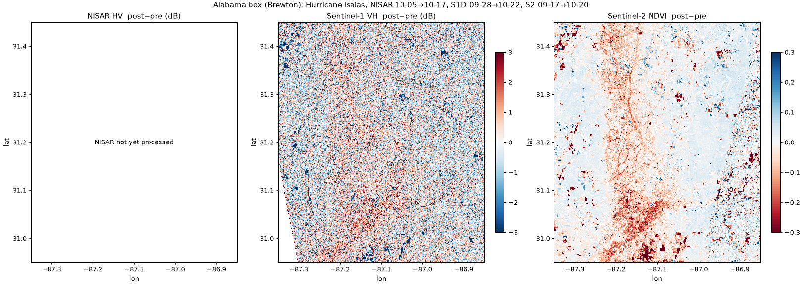
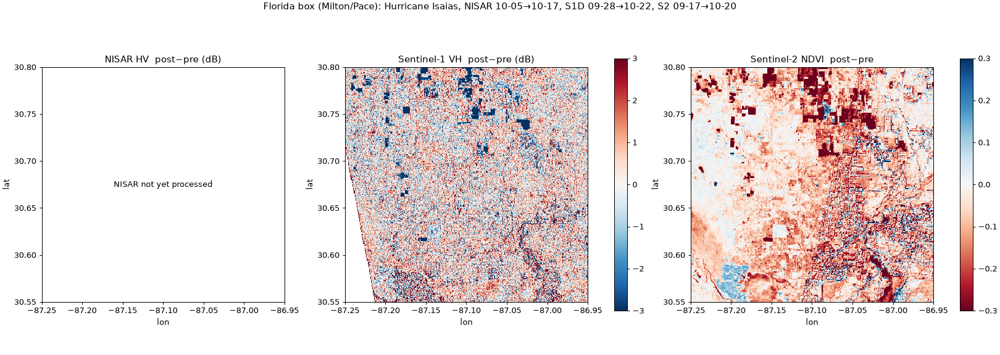
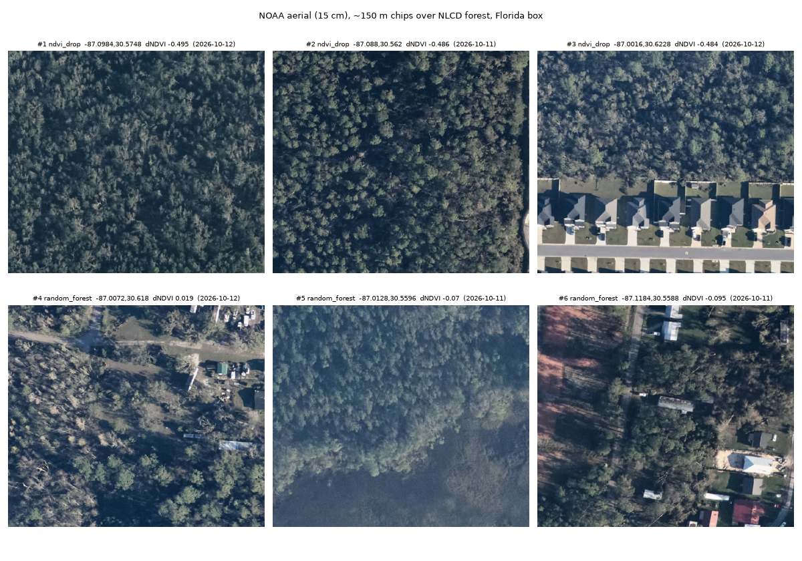

# Blowdown gate check: Hurricane Isaias (2026-10-10)

**Status: INCOMPLETE. The NISAR step is blocked, so there is no PASS/FAIL verdict yet.**
The NISAR download fails with Earthdata "Pre authorization required" for the ASF data-access app
(`client_id=BO_n7nTIlMljdvU6kRRB3g`). John has to approve that app on his Earthdata account. Everything else below is done.

## Inputs

| Source | Pre | Post | Notes |
|---|---|---|---|
| NISAR GCOV (`_PR_`, track 76, frame 17, asc.) | 2026-10-05 11:02:24Z | 2026-10-17 11:02:24Z | Each scene was also listed as a `_UR_` duplicate; took `_PR_`. Both frames fully contain both boxes. |
| Sentinel-1 GRD (EE `COPERNICUS/S1_GRD_FLOAT`, rel. orbit 19, asc., IW) | 2026-09-28 | 2026-10-22 | **Sentinel-1D is in the EE collection** (all scenes are `S1D_IW_GRDH_1SDV_…`), so no ASF download was needed. The swath edge leaves 2% of the AL box and 4% of the FL box with no data (western corner). One S4 stripmap scene on 10-22 was excluded. |
| Sentinel-2 SR (EE `S2_SR_HARMONIZED`) | 2026-09-17 | 2026-10-20 | Picked by cloud fraction **inside each box** (SCL classes 3/8/9/10 + no-data), not tile cloud %. |
| NOAA aerial (`…/HURRICANE_ISAIAS_2026`) | n/a | 2026-10-10 to 10-13 | 15 cm RGB |
| Land cover | Annual NLCD 2025 (`Annual_NLCD_LndCov_2025_CU_C1V2`) | | forest = 41, 42, 43, 90 |

### Sentinel-2 scenes and cloud cover

| Box | Pre date | In-box cloud | Tile cloud % | Post date | In-box cloud | Tile cloud % |
|---|---|---|---|---|---|---|
| AL | 2026-09-17 | 0.5% | 0.9, 10.5 | 2026-10-20 | 0.0% | 0.1, 0.0, 0.1, 0 |
| FL | 2026-09-17 | 0.0% | 1.1, 0.9, 9.0, 10.5 | 2026-10-20 | 0.0% | 0.0–0.1 (6 granules) |

## NISAR files

| Scene | File | Size |
|---|---|---|
| Pre | `NISAR_L2_PR_GCOV_032_076_A_017_4005_DHDH_A_20261005T110224_20261005T110258_P05023_N_F_J_001.h5` | 6,002,049,024 B (6.00 GB) |
| Post | `NISAR_L2_PR_GCOV_033_076_A_017_4005_DHDH_A_20261017T110224_20261017T110259_P05023_N_F_J_001.h5` | 6,165,626,880 B (6.17 GB) |

Download time: **not measured yet (blocked).** Peak RAM: **not measured yet.**
Both are under the 10 GB limit. Sizes come from the ASF search metadata.

## Figures

All three panels in each figure share one EPSG:4326 grid at 0.0008° (~80 m).
Colours are set so that **red = expected damage** in every panel: radar backscatter increase is red, NDVI drop is red.

## What is visible

**Alabama box.** Sentinel-2 NDVI shows a coherent north–south band of canopy loss along roughly lon −87.17 to −87.10,
widening to the south (−87.15, 31.05). Its edges are **branching (dendritic)**, following the drainage network,
so it may be bottomland/riparian forest damage, or flood effects, rather than a clean wind swath. I can't separate those from these data.
The small blocky drops are almost certainly ordinary clearcuts. Sentinel-1 VH is speckle-dominated, with only a faint
positive band in the same southern area. Inside the NDVI-drop forest mask, VH changed by +0.46 dB, against −0.12 dB in forest with no drop
(Pearson r vs dNDVI over forest = −0.14). That's a weak agreement.

**Florida box.** NDVI drops broadly across most of the box, so there is no distinct linear swath. The strongest drops (dNDVI < −0.5)
are **flood water** along the Blackwater/Yellow River margins, confirmed in the aerial chips. Sentinel-1 shows that
water as a strong VV/VH decrease. Over forest, S1 VH is +0.50 dB in NDVI-drop areas vs +0.15 dB elsewhere (r = −0.09).

Agreement stats are in [stats.json](stats.json). The NDVI-drop mask is forest with −0.5 < dNDVI < −0.10; the no-drop mask is forest with dNDVI ≥ −0.02.

## Aerial truth (Florida box)

- Asset: ImageCollection with 5,599 RGB tiles (15 cm), flown 2026-10-10 to 2026-10-13.
  Bounds of the whole collection: lon −89.66 to −85.22, lat 29.42 to 30.81 (bounding box, not a dissolved outline).
  **None of the tiles reach the Alabama box.**
- Inside the Florida box: 236 tiles, dissolved footprint **256.3 km²** of the box's 797.6 km².
- **Forest inside the aerial footprint within the Florida box: 99.3 km²** (of 388.1 km² forest in the whole box).

Six ~150 m chips over NLCD forest inside the footprint: three at a moderate NDVI drop, three random (seed 7).
I first picked the three strongest drops, but all three were flood water, so I re-picked with −0.5 < dNDVI < −0.15.

Downed and leaning trees are **clearly visible in chip #4**. In the other chips the canopy looks mostly intact, with possibly
a few scattered fallen stems. At 15 cm individual windthrow is resolvable, so the aerial set can serve as truth where it overlaps.

## Not verified

- Everything NISAR: HDF5 structure, CRS and posting match across cycles, HH/HV differences, download time, peak RAM.
- Whether the Alabama NDVI band is wind damage or flooding/riparian effects.
- Clearcut vs storm loss for the small blocky NDVI drops (I didn't use a harvest mask).
- Sentinel-1 corner gaps (2–4% of each box) are masked, not filled.

## Verdict

**PENDING: NISAR has not been downloaded.** On the optical/C-band evidence alone, Alabama is the box most likely to pass.
Florida's signal is dominated by flooding.
