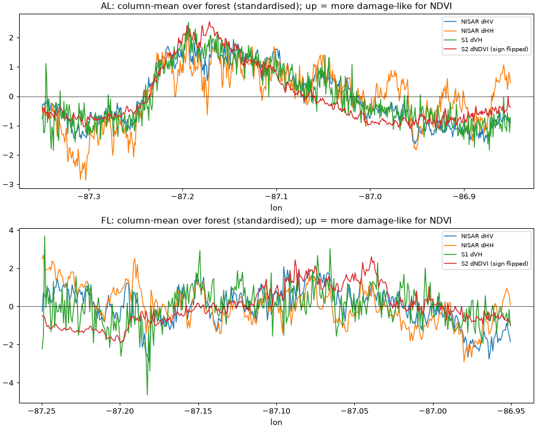

# Blowdown gate check: Hurricane Isaias (2026-10-10)

**PASS: in the Alabama box the damage band shows in the NISAR HV difference and lines up with the Sentinel-2 NDVI drop (column-profile r = −0.88; HV is +0.52 dB higher where NDVI dropped). Florida shows no distinct swath.**

Caveat on the verdict: the Alabama band has branching (dendritic) edges, and I could not confirm whether it is wind damage or riparian/flood effects (see "Not verified").

## Inputs

| Source | Pre | Post | Notes |
|---|---|---|---|
| NISAR GCOV (`_PR_`, track 76, frame 17, asc.) | 2026-10-05 11:02:24Z | 2026-10-17 11:02:24Z | Each scene was also listed as a `_UR_` duplicate; took `_PR_`. Both frames fully contain both boxes. |
| Sentinel-1 GRD (EE `COPERNICUS/S1_GRD_FLOAT`, rel. orbit 19, asc., IW) | 2026-09-28 | 2026-10-22 | **Sentinel-1D is in the EE collection** (all scenes are `S1D_IW_GRDH_1SDV_…`), so no ASF download was needed. The swath edge leaves 2% of the AL box and 4% of the FL box with no data (western corner). One S4 stripmap scene on 10-22 was excluded. |
| Sentinel-2 SR (EE `S2_SR_HARMONIZED`) | 2026-09-17 | 2026-10-20 | Picked by cloud fraction **inside each box** (SCL classes 3/8/9/10 + no-data), not tile cloud %. |
| NOAA aerial (`…/HURRICANE_ISAIAS_2026`) | n/a | 2026-10-10 to 10-13 | 15 cm RGB |
| Land cover | Annual NLCD 2025 (`Annual_NLCD_LndCov_2025_CU_C1V2`) | | forest = 41, 42, 43, 90 |

### Sentinel-2 scenes and cloud cover

| Box | Pre date | In-box cloud | Tile cloud % | Post date | In-box cloud | Tile cloud % |
|---|---|---|---|---|---|---|
| AL | 2026-09-17 | 0.5% | 0.9, 10.5 | 2026-10-20 | 0.0% | 0.1, 0.0, 0.1, 0 |
| FL | 2026-09-17 | 0.0% | 1.1, 0.9, 9.0, 10.5 | 2026-10-20 | 0.0% | 0.0–0.1 (6 granules) |

## NISAR files, timing, memory

| Scene | File | Size | Download time |
|---|---|---|---|
| Pre | `NISAR_L2_PR_GCOV_032_076_A_017_4005_DHDH_A_20261005T110224_20261005T110258_P05023_N_F_J_001.h5` | 6,002,049,024 B (6.00 GB) | 859 s |
| Post | `NISAR_L2_PR_GCOV_033_076_A_017_4005_DHDH_A_20261017T110224_20261017T110259_P05023_N_F_J_001.h5` | 6,165,626,880 B (6.17 GB) | 837 s |

- The two files took 28 min in total, downloaded one after the other at about 7 MB/s. The bytes on disk match the ASF metadata exactly.
- **Peak RAM** for the NISAR processing was **2.70 GB** (Windows peak working set; the run took 22 s). The download process peaked at 77 MB.
- **Structure** (inspected, product spec v1.5.0). Backscatter is in `/science/LSAR/GCOV/grids/frequencyA/HHHH` and `HVHV`: float32 linear gamma0 (RTC), NaN fill, 34344 × 34920 px, 512² gzip chunks.
- **Grid:** EPSG:32616 (UTM 16N) at 10 m. Both cycles have an identical grid (same origin and posting), checked in code before subtracting. frequencyB (the coarse 5 MHz layer) was not used.
- **Validity mask:** `mask` = 0 means partially focused and 255 means outside the acquisition. Both are masked, and 0% of either box was affected. `hasInputDataException` = 0 in both files.
- **Processing:** I read only the box window plus 0.01° of margin, applied a NaN-aware 5×5 boxcar (50 m) in linear power, converted to dB, took post − pre at 10 m, then mean-aggregated onto the shared figure grid.
- **Offset:** there is a scene-wide offset of about −0.85 dB HV and −0.8 dB HH, probably calibration or soil moisture. It's removed from the map panels (stated in each panel title) and doesn't affect the contrasts below.

## Figures

All three panels in each figure share one EPSG:4326 grid at 0.0008° (~80 m), with the same extent.
Colours are set so that **red = expected damage** in every panel: radar backscatter increase is red, NDVI drop is red.

Column-mean profiles over forest (water excluded), standardised. A north–south swath shows up as a shared bump:

## Is a linear swath visible, and do the three agree?

| | NISAR HV | Sentinel-1 VH | Sentinel-2 NDVI | Agree? |
|---|---|---|---|---|
| **AL** | **Yes.** N–S band of relative HV increase, lon ≈ −87.22 to −87.05, sharp western edge at −87.23, bulge near (−87.12, 31.05) | Faint, same band, speckle-dominated | **Yes.** Clear N–S band of canopy loss, same position and edge | **Yes.** Profile r vs dNDVI: NISAR HV −0.88, S1 VH −0.89, NISAR HH −0.66 |
| **FL** | No distinct swath; patchy | No distinct swath | Broad drop over most of the box, no linear band; strongest drops are flood water | Weak. Profile r: NISAR HV −0.39, S1 VH −0.41, NISAR HH +0.08 |

Contrast over NLCD forest, with "NDVI drop" defined as −0.5 < dNDVI < −0.10 and "no drop" as dNDVI ≥ −0.02. dNDVI < −0.5 is excluded because it is mostly flood water.

| Box | NISAR dHV drop / no-drop (dB) | NISAR dHH drop / no-drop (dB) | S1 dVH drop / no-drop (dB, offset-removed) | pixel-level r (NISAR HV, S1 VH) |
|---|---|---|---|---|
| AL | −0.45 / −0.97 (**+0.52**) | −0.26 / −0.76 (+0.49) | +0.48 / −0.11 (+0.59) | −0.27, −0.14 |
| FL | −0.42 / −0.66 (+0.24) | −0.71 / −0.98 (+0.27) | +0.16 / −0.19 (+0.34) | −0.12, −0.09 |

The swath is clear in both radars when you average along it (profiles). At ~80 m per pixel it's noisy, with low pixel-level r. HH rises about as much as HV inside the Alabama band. A flooded forest would normally give a much larger HH (double-bounce) jump, so that is weak evidence against flooding on 10-17. It isn't proof.

Raw numbers: [stats.json](stats.json), [profiles.json](profiles.json).

## Aerial truth (Florida box)

- Asset: ImageCollection with 5,599 RGB tiles (15 cm), flown 2026-10-10 to 2026-10-13.
  Bounds of the whole collection: lon −89.66 to −85.22, lat 29.42 to 30.81 (bounding box, not a dissolved outline).
  **None of the tiles reach the Alabama box**, so the box that passes has no aerial truth.
- Inside the Florida box: 236 tiles, dissolved footprint **256.3 km²** of the box's 797.6 km².
- **Forest inside the aerial footprint within the Florida box: 99.3 km²** (of 388.1 km² forest in the whole box).

Six ~150 m chips over NLCD forest inside the footprint: three at a moderate NDVI drop, three random (seed 7).
I first picked the three strongest drops, but all three were flood water, so I re-picked with −0.5 < dNDVI < −0.15.
Locations and values are in [thumbs/thumbs.json](thumbs/thumbs.json).

Downed and leaning trees are **clearly visible in chip #4**. In the other chips the canopy looks mostly intact, with possibly
a few scattered fallen stems. At 15 cm individual windthrow is resolvable, so the aerial set can serve as truth where it overlaps.

## Not verified

- **What causes the Alabama band:** wind blowdown, or riparian/bottomland effects (flooding, leaf stripping), given its dendritic edges. There is no aerial imagery or field data there.
- **Range-direction trends:** the profiles run east–west, which is roughly NISAR's range direction, so an incidence-angle trend could add a smooth gradient. The sharp shared edge at −87.23 argues against that explaining the match, but I didn't model it.
- **Clearcuts:** the small blocky changes (strong in both NISAR and NDVI) are probably harvests, not storm damage. I didn't use a harvest mask.
- **Non-forest changes:** the large negative NISAR HV patches in Alabama are non-forest fields and are not interpreted.
- **Sentinel-1 gaps:** the corner gaps (2–4% of each box) are masked, not filled.
- **NISAR product status:** the `_PR_` products are provisional (`NISAR_L2_GCOV_PROVISIONAL_V1`), so calibration may change; that may be where the −0.85 dB offset comes from.

## Reproduce

Scripts are in `scripts/`, run with `.venv/Scripts/python -I`. Run them in order: `nisar_search`, `nisar_download data/nisar`, `s1_check`/`s1_cover`, `s2_select`,
`noaa_forest`, `ee_panels`, `noaa_thumbs`, `nisar_process data/nisar`, `make_figures`, `swath_profile`. `data/` is git-ignored.
