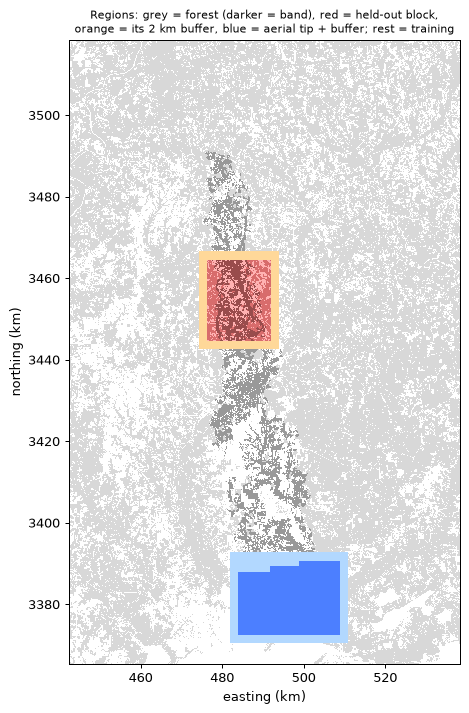

# Model design (frozen before any model is trained)

Branch `models`. Grid, masks, Sentinel-2 damage mask and upland mask as in [controls.md](../pipeline/controls.md).

Region selection and features are in commit `74c1f162e93e450901c50064fa861ffa4a327e06`:
- [regions.py](../../scripts/regions.py) → [regions.json](regions.json)
- [features.py](../../scripts/features.py) → [feature_coverage.json](feature_coverage.json)

This file is committed on its own. Anything changed after this commit is listed as a deviation in `train.md` or the scoring report.

## 1. Prediction grid

The grid is 30 m in EPSG:32616 with origin x 442,360, y 3,518,430, and 5,100 × 3,200 cells (the pipeline's evaluation extent). Predictions cover forest cells only.

Cell classes are shares of the nine 10 m pixels in a 30 m cell:

| Class | Rule |
|---|---|
| Forest | reference forest share ≥ 0.5 |
| Damage | forest, and Sentinel-2 damage share ≥ 0.5 |
| Intact | forest, intact share ≥ 0.9, and not damage |
| Upland | forest, and upland-forest share ≥ 0.5 (NLCD evergreen or deciduous with MERIT HAND > 5 m) |
| Wetland | forest, and woody-wetland share ≥ 0.5 |

Mixed forest and low-HAND pine fall in neither the upland nor the wetland domain. They are predicted but not sampled for labels: 11.6 of the held-out block's 77.1 km² of damage (15%).

## 2. Regions

**Held-out block.** Lat 31.1351–31.3158, lon −87.2489 to −87.0857. In UTM 16N that's easting 476,320–491,830 and northing 3,444,600–3,464,610 (20.0 × 15.5 km; grid rows 1794–2461, cols 1132–1649). It holds 223.1 km² of forest and 77.1 km² of damage, with an upland share of damage of 0.325 against the band-wide target of 0.324.

Nothing inside the block is used for training, tuning, normalisation statistics or checkpoint selection. The same applies to a 2 km buffer around it: easting 474,310–493,840, northing 3,442,590–3,466,620.

**How it was chosen.** A 20 km northing window slides along the band (pipeline extent mask) in 1 km steps. The block is the bounding rectangle of the band cells in the window, widened by 1 km east and west. The pick is the window whose upland share of all 10 m damage pixels in the block is closest to 0.324.

Conditions added to John's rule:
- the block plus buffer must not touch the tip exclusion;
- it must hold at least 100 cells each of damaged upland, intact upland, damaged wetland and non-damaged wetland, so the label sample can be drawn;
- the 1 km step and the 1 km widening.

John's literal rule (both damaged and intact upland present, closest share) picks the same window. 78 of 100 windows were eligible, with shares from 0.236 to 0.485.

**Aerial tip (secondary check).** The band cells inside the NOAA aerial footprint are at the band's southern end. The tip block is their bounding rectangle widened by 1 km east and west, intersected with the footprint: lat 30.4855–30.6502, lon −87.1695 to −86.9080.
- It holds 173.1 km² of forest, about 2.5 times the band forest there (67.7 km²), because the rectangle takes in forest beside the band.
- Its damage is 69.7 km², and it has only 212 intact upland cells.
- The tip plus a 2 km buffer is excluded from training: easting 481,750–510,820, northing 3,370,590–3,392,850.

**Training region.** The analysis extent minus both exclusions: 8,922 km² of forest.

**Radar coverage.** Every forest cell in the held-out block and in the tip has valid data from track 76, track 55, orbit 19 and orbit 92. In the training region, 96.8% of forest cells have at least one NISAR track and 100% have at least one S1 orbit; orbit 19 covers 74.6%.

## 3. Inputs (30 m, from features.py)

| Group | Layers |
|---|---|
| NISAR track 76 | HH and HV pre (mean of 09-23 and 10-05), post (mean of 10-17 and 10-29), diff |
| NISAR track 55 | HH and HV pre (09-22, 10-04), post (10-16, 10-28), diff |
| S1 orbit 19 | VV and VH pre (09-28), post (10-22), diff |
| S1 orbit 92 | VV and VH pre (mean of 09-21 and 10-03), post (10-27), diff |
| Context | HAND (MERIT, m); NLCD forest class (1 evergreen, 2 deciduous, 3 mixed, 4 woody wetland) |

How the layers are built:
- Each scene is averaged to 30 m in linear power, needing at least 5 of 9 valid 10 m pixels. Scenes are averaged across the stack in linear power, then converted to dB.
- diff = post − pre, re-centred on its median over all forest cells of the grid, as in pipeline.md. This is one label-free constant per layer computed over the whole scene, held-out block included.
- For the gradient-boosted models, 3×3 and 7×7 NaN-aware neighbourhood means of every radar layer are computed on the full grid before cropping.

## 4. Training labels

From the Sentinel-2 damage mask at 30 m: 1 = damage cell, 0 = intact cell. Other cells are unused. Removed:
- **Clearcut/salvage flag:** cells with any 10 m pixel in the reference flag (7,652 cells).
- **Clearing after 10-29:** cells flagged in controls.md (Sentinel-2 NDVI after 10-29 below 0.35 with a drop of more than 0.15), 2,340 cells.
- **Mask edge:** damage cells with any non-damage forest cell in their 3×3 window, and intact cells with any damage cell in their 3×3 window (331,794 cells). The 3×3 window was chosen over 5×5 before training because 5×5 kept only 22% of damage cells; 3×3 keeps 43%.

Result in the training region: 248,131 damage cells and 3,075,249 intact cells.

## 5. Spatial validation split (inside the training region)

- **Tiles:** 320 × 320 cells (9.6 km) from the grid origin. A tile is eligible if it has at least 500 labelled training cells.
- **Draw:** 20% of eligible tiles become validation, with `numpy.random.default_rng(s)`, starting at s = 0.
- **Redraw rule:** accept the first s for which the validation tiles hold at least 5,000 damage cells in upland, at least 5,000 in wetland, and at least 15% of all labelled damage cells. The s used is reported.
- **Guard band:** training cells within 4 cells (120 m) of a validation tile are not used for training.

Validation is used for tuning, checkpoint selection, thresholds and the reported validation numbers. Normalisation statistics (mean and sd per input) come from training tiles only.

## 6. Arms

**A: NISAR HV threshold.** Score = mean of the track 76 and track 55 HV diff (NaN-aware), as pipeline arm A.
- Pre-declared labelled variant **A76**: track 76 HV diff alone.

**B: Sentinel-1 VH threshold.** Score = NaN-aware mean of the orbit 19 and orbit 92 VH diff, October-only posts.

**C / D / E: models.** Inputs:
- C: NISAR layers only
- D: S1 layers only
- E: both

Every model arm also gets HAND and the NLCD class. Each model arm has two models:

- **Gradient boosting (LightGBM, binary):**
  - Features: per-pixel layers, their 3×3 and 7×7 means, HAND, and NLCD as a categorical.
  - Training sample: all labelled damage cells in training tiles, plus 4 times as many intact cells drawn at random (seeded).
  - Tuning on seed 0: num_leaves {31, 127} × min_data_in_leaf {100, 1000}. Fixed: learning rate 0.05, feature_fraction 0.8, bagging 0.8. Up to 3,000 rounds with early stopping (100) on validation AUC, using validation cells subsampled to at most 1M.
  - The best configuration by validation AUC is retrained with seeds 0–4, each with its own early stopping.
- **U-Net:**
  - Architecture: 3 levels (32, 64, 128 channels), two 2× poolings, BatchNorm and ReLU.
  - Inputs: per-pixel radar layers of the arm, standardised with training-tile statistics with NaN set to 0, plus one validity channel per geometry (track or orbit), standardised HAND, and NLCD one-hot (4).
  - Patches: 64 × 64 on a stride-32 lattice, kept only if wholly inside training tiles (guard band included) and containing a labelled cell.
  - Training: loss is BCE with pos_weight 4 on labelled cells only; AdamW with weight decay 1e-4, batch 32, 30 epochs, flips and 90° rotations.
  - Learning rate {1e-3, 3e-4}, chosen on seed 0 by validation AUC.
  - Checkpoint = epoch with best validation AUC. Validation tiles are predicted whole, since the network is fully convolutional.
  - Seeds 0–4.

**Score of a model arm** = mean predicted probability over its 5 seeds. Per-seed spread is reported.

**Thresholds (frozen):** for each arm, A76 included, the threshold maximising F1 for the damaged class on the validation labelled cells.

**Freezing:** all model files and thresholds are written to `data/models/frozen/`, and their sha256 hashes are committed in `docs/models/frozen_manifest.json` before any held-out scoring.

## 7. Hand labels and the one scoring pass

**Sample** (labeling_build.py, seed 2026). The frame is forest cells of the block where every arm can predict (at least one NISAR track and one S1 orbit valid), which is every forest cell in both blocks.
- Held-out: 400 cells, 100 per stratum: upland or wetland, crossed with inside or outside the Sentinel-2 damage mask.
- Tip: 150 cells: upland 37 inside and 38 outside, wetland 38 inside and 37 outside. A stratum with too few cells gives all it has, and that is recorded.

**Blinding:**
- Cell ids are random 8-hex strings, and the display order is a random permutation.
- The id-to-stratum key is `data/models/labeling_key.csv`. It is outside `labeling/`, the zip and git; only its sha256 is committed.
- The page shows imagery only.

**Scoring** (one pass, after John's labels are done):
- Labels: Damaged = 1, Intact = 0. Unsure cells are excluded and counted.
- **Primary:** AUC (continuous score) and F1 for the damaged class (frozen threshold), on John's labels in the held-out block, separately for upland and wetland, unweighted on the labelled sample.
  - The sample is about 50/50 by design, so F1 compares arms; it is not a map accuracy.
- **Secondary:**
  - stratum-weighted AUC and F1, each stratum weighted by frame cells per drawn cell;
  - the aerial tip, scored the same way;
  - A76;
  - per-seed results;
  - agreement of the Sentinel-2 mask itself with John's labels.
- **CIs:** block bootstrap over 2 km × 2 km tiles inside the block, 2,000 resamples, percentile 95% intervals.
- **Paired contrasts:** E−C, E−D, C−A, D−B, C−D, A−B, each per domain, with the same bootstrap.
- Everything computed is reported, including results that go against NISAR.

## 8. Known limits, stated before training

- **The earlier analyses covered the held-out area.** The gate's Alabama box overlaps it, and pipeline.md and controls.md scored the whole grid, held-out block included. Choices such as October-only S1 posts, the stack dates and the HV-first framing were informed by data that includes it. No model, threshold or statistic in this design is fit there.
- **Re-centring constants** come from the whole-scene forest median, held-out block included. They are label-free.
- **Shared imagery.** John labels from the same Sentinel-2 composites that define the training labels, plus aerial photos in the tip. Agreement between the models and John is therefore partly agreement with Sentinel-2.
- **The tip block** is much wider than the band there, and has few intact upland cells.
