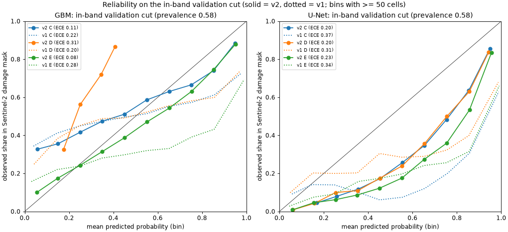

# Model training (validation only)

Branch `models`. Design frozen in [design.md](design.md) (commit `fe4e253`) before any training.

Arms A–E were trained and tuned only on the training region, using the spatial validation split in [split.json](split.json). Models and thresholds are frozen and hashed in [frozen_manifest.json](frozen_manifest.json).

**Nothing inside the held-out block or the aerial tip was opened, scored or plotted by any training step.**
- Training reads `features_train.h5`, where both exclusions (block + 2 km) are blank, and `split.npz`.
- The diagnostic also reads the whole-grid masks in `regions_30.npz` (damage, intact, band, upland, wetland), but only inside validation tiles.

Scripts:
- [train_split.py](../../scripts/train_split.py)
- [train_gbm.py](../../scripts/train_gbm.py)
- [train_unet.py](../../scripts/train_unet.py)
- [train_diag.py](../../scripts/train_diag.py)

Numbers: [train_gbm.json](train_gbm.json), [train_unet.json](train_unet.json), [train_diag.json](train_diag.json).

## Read this first: the validation numbers don't describe John's task

On the design labels the learned models reach validation AUC 0.97–0.9996. Don't expect that on John's labels. The diagnostic re-scores the frozen models on the same validation tiles with other label sets:

| Score, validation tiles | Design labels (edge / flag cells removed) | All damage vs all intact | Outside the band: damage vs intact | Inside the band: damage vs intact | **Inside the band, mask vs all other forest: upland** | **…: wetland** |
|---|---|---|---|---|---|---|
| A: NISAR HV threshold | 0.709 | 0.678 | 0.691 | 0.672 | 0.566 | 0.607 |
| A76: track 76 HV threshold | 0.738 | 0.717 | 0.722 | 0.633 | 0.549 | 0.580 |
| B: S1 VH threshold | 0.681 | 0.649 | 0.653 | 0.648 | 0.553 | 0.577 |
| A smoothed 7×7 (not an arm) | 0.859 | 0.819 | 0.827 | 0.779 | 0.600 | 0.697 |
| A76 smoothed 7×7 (not an arm) | 0.916 | 0.895 | 0.891 | 0.712 | 0.578 | 0.673 |
| B smoothed 7×7 (not an arm) | 0.873 | 0.844 | 0.825 | 0.799 | 0.602 | 0.669 |
| GBM C (NISAR) | 0.9799 | 0.9277 | 0.9557 | 0.684 | 0.626 | 0.727 |
| GBM D (S1) | 0.9729 | 0.8899 | 0.9048 | 0.778 | 0.691 | 0.712 |
| GBM E (both) | 0.9948 | 0.9482 | 0.9693 | 0.804 | 0.735 | 0.776 |
| U-Net C (NISAR) | 0.9968 | 0.9845 | 0.9865 | 0.728 | 0.687 | 0.747 |
| U-Net D (S1) | 0.9986 | 0.9913 | 0.9877 | 0.804 | 0.725 | 0.728 |
| U-Net E (both) | 0.9996 | 0.9945 | 0.9924 | 0.810 | 0.756 | 0.777 |

Cell counts:
- **Outside the band:** 78,127 damage against 679,053 intact cells.
- **Inside the band, damage vs intact:** 44,882 damage against only 220 intact cells, so that column is noisy.
- **Last two columns:** one common set of cells where every arm has a score. Upland is 16,352 damage against 17,306 other cells; wetland is 11,699 against 4,272.

**What this shows:**
- **The high validation scores are not explained by band membership.** Outside the band the models still score 0.90–0.99. Why they score so high there isn't established. The likely main factor is the label construction: the design labels pit core damage cells against cells at least 90% intact and clear of damage, with the in-between cells removed.
- **The task closest to John's sample is the last two columns:** inside the band, Sentinel-2 damage cells against all other forest cells. There every arm drops sharply:
  - plain thresholds 0.55–0.61;
  - smoothed thresholds 0.58–0.70;
  - learned models 0.63–0.78, with arm E (both sensors) best in both domains (GBM 0.735 / 0.776, U-Net 0.756 / 0.777).
  - These columns measure agreement with the Sentinel-2 mask, not ground truth.
- **The training labels never cover most of the cells John will label as "outside the mask."** In the held-out block, only 6.7% of upland out-of-mask cells (6,216 of 93,407) and 4.7% of wetland ones (2,058 of 43,784) meet the intact class. The rest, about 93–95%, are partly damaged, edge or otherwise in-between cells that the models never saw as either class.
  - That's a property of the training labels, not only of validation.
  - Retraining with in-band negatives would be a declared deviation from the frozen design. It's John's call, before the scoring pass.
- **Much of the gain over plain thresholds is spatial smoothing.** 70–82% of LightGBM gain is on 7×7 means, and smoothed thresholds alone reach 0.86–0.92 on the design labels.

## Validation results per arm (design labels)

Validation = 30 spatial tiles (9.6 km), 50,704 damage cells and 670,329 intact cells. 12,101 of the damage cells are in upland and 32,732 in wetland.

Each cell shows AUC / F1 for the damaged class. F1 is at the frozen threshold, which was itself chosen on these validation cells, so **F1 here is in-sample and optimistic**. The validation prevalence is about 7%, unlike John's roughly 50/50 sample, so these F1 values don't carry over.

Model arms use the 5-seed mean probability.

| Arm | All forest | Upland | Wetland | Seed range (AUC, all) |
|---|---|---|---|---|
| A: NISAR HV threshold (mean of tracks) | 0.709 / 0.270 | 0.546 / 0.098 | 0.747 / 0.465 | n/a |
| A76: track 76 HV threshold | 0.738 / 0.307 | 0.630 / 0.156 | 0.732 / 0.444 | n/a |
| B: S1 VH threshold (October posts) | 0.681 / 0.243 | 0.540 / 0.077 | 0.741 / 0.443 | n/a |
| C GBM (NISAR) | 0.980 / 0.847 | 0.940 / 0.615 | 0.994 / 0.935 | 0.9793–0.9799 |
| D GBM (S1) | 0.973 / 0.830 | 0.939 / 0.617 | 0.989 / 0.930 | 0.9725–0.9727 |
| E GBM (both) | 0.995 / 0.922 | 0.983 / 0.798 | 0.999 / 0.970 | 0.9944–0.9948 |
| C U-Net (NISAR) | 0.9968 / 0.947 | 0.9895 / 0.852 | 0.9992 / 0.981 | 0.9956–0.9961 |
| D U-Net (S1) | 0.9986 / 0.964 | 0.9957 / 0.906 | 0.9997 / 0.989 | 0.9978–0.9982 |
| E U-Net (both) | 0.9996 / 0.975 | 0.9986 / 0.934 | 0.9999 / 0.991 | 0.9988–0.9994 |

Upland is the harder domain for every arm, and the plain thresholds are near chance there (0.54–0.63).

**Frozen thresholds:**
- A: +0.757 dB
- A76: +1.045 dB
- B: +1.633 dB
- GBM: C 0.826, D 0.814, E 0.847
- U-Net: C 0.856, D 0.570, E 0.598

**Tuning choices** (seed 0, validation AUC):
- GBM C: 127 leaves, min leaf 100. Best iterations across seeds 772–1,660.
- GBM D: 31 leaves, min leaf 1,000. 1,968–2,635 iterations.
- GBM E: 127 leaves, min leaf 1,000. 1,001–1,631 iterations.
- The tuning grids differed by less than 0.002 AUC.
- U-Net learning rate: C 1e-3, D and E 3e-4. The two rates differed by less than 0.0005.
- U-Net best epochs: 18–29 of 30, so longer training might help a little. It wasn't tried, because the design fixed 30 epochs.
- U-Net training used 10,013 patches.

## Feature importance (LightGBM, share of total gain, mean of 5 seeds)

| Arm | Top features | By scale | Context (HAND + NLCD) |
|---|---|---|---|
| C (NISAR) | track 76 HV diff 7×7 0.369, track 76 HV diff 3×3 0.098, track 55 HV diff 7×7 0.070, track 55 HV pre 7×7 0.044, track 76 HH diff 7×7 0.041 | per-pixel 0.045, 3×3 0.214, 7×7 0.704 | 0.037 |
| D (S1) | orbit 19 VH diff 7×7 0.291, orbit 19 VH post 7×7 0.131, orbit 92 VH diff 7×7 0.119, orbit 92 VH post 3×3 0.100, orbit 92 VH post 7×7 0.049 | per-pixel 0.026, 3×3 0.211, 7×7 0.738 | 0.025 |
| E (both) | track 76 HV diff 7×7 0.311, orbit 19 VH diff 7×7 0.127, track 55 HV post 7×7 0.056, orbit 19 VH post 7×7 0.056, track 55 HV diff 7×7 0.055 | per-pixel 0.028, 3×3 0.144, 7×7 0.820 | 0.008 |

Grouped over scales:
- **C:** track 76 HV diff carries 0.47 of the gain. Track 55 HV diff 0.09, track 76 HH diff 0.06, track 55 HV pre/post 0.11.
- **D:** orbit 19 VH diff 0.30, orbit 19 VH post 0.16, orbit 92 VH post 0.15, orbit 92 VH diff 0.13. VV is minor.
- **E:** track 76 HV diff 0.33, then orbit 19 VH diff 0.13. In the combined model, NISAR track 76 HV is the single strongest input.

The post-only levels (VH post, HV post) are fairly important. They can carry land-cover and geometry information as well as change.

## Time and disk

| Item | Time | Disk |
|---|---|---|
| Deleted `data/layers.h5` (rebuild command in README) | n/a | −36.1 GB |
| Installed scikit-learn 1.9.1, LightGBM 4.7.0, PyTorch 2.11 (CUDA 12.8) in .venv | a few minutes | several GB in .venv (not measured) |
| S1 VV per-date pull at 30 m (Earth Engine) | 8 min | small |
| Regions + 30 m features (three files) | about 1.5 min per run, 3 runs | 3.3 GB (`data/models/features_*.h5`) |
| Labeling set: sample, S2 and aerial pulls, rendering, page, zip | 7 min | 30 MB folder + 30 MB zip |
| LightGBM (A, A76, B thresholds; C, D, E tuning + 5 seeds) | 30 min | 15 GBM model files, 219.5 MB |
| U-Net (C, D, E; 2 learning rates + 5 seeds; RTX 5070) | 55 min | 15 U-Net files, 28.9 MB |
| Validation diagnostic (run twice) | 3 min each | n/a |

Free disk is about 660 GB (615 GiB). `data/` dropped from 62 GB to 32 GB.

## Deviations and additions after the design commit

- **Added:** the validation diagnostic (`train_diag.py`). It changes nothing that was frozen.
- **Labeling page fixes after the design commit (no change to the sample):** a storage check at load, and a fix for the label buttons all showing as selected on unlabelled cells.
- **Implementation details not in the design:**
  - F1 thresholds are searched over the 50th–99.5th percentiles of the validation score.
  - A U-Net validity channel is 1 where all six layers of that geometry are finite.
- **No other deviations.** The split rule accepted seed 0 at the first draw.

## Not verified

- **Held-out performance is unknown and likely much lower than validation** (see the diagnostic). It will be measured once, after John's labels.
- **Spatial independence of validation.** Validation tiles border training tiles behind only a 120 m guard band, and the band runs through both. Validation is not independent of training at the band scale.
- **F1 at the frozen threshold** is in-sample on validation.
- **The labeling page.** The unzipped copy of `labeling.zip` was opened from `file://` in headless Chrome: it shows Cell 1 of 550, the image loads, and storage works (no warning). Labelling, reload persistence, going back and the CSV export were tested over `http://localhost`, not over `file://`. Edge, Firefox and Safari were not tested from `file://`. The page warns if the browser won't save.
- **Labeling imagery.** I checked a few rendered images by eye, not all 550. Some may show cloud, haze or flooding in the composites. John's Unsure button covers those. 2 of the 150 tip cells fall in aerial gaps and say so.
- **README rebuild command** for `data/layers.h5` was checked against the script's inputs, not re-run.
- **The training labels are Sentinel-2-derived** and provisional, and John labels from the same composites.

## Amendment 1: v1 vs v2 on validation tiles

v2 changes only the training labels (design.md, Amendment 1). Every training-region forest cell is labelled: in the Sentinel-2 damage mask or not, with flagged cells excluded. That gives 577,835 label-1 and 9,002,841 label-0 cells, against v1's 248,131 and 3,075,249. Selection uses the in-band validation cut.

v1 was not retrained. It was moved unchanged to `data/models/v1/` (all 41 hashes re-verified, [v1_hashcheck.json](v1_hashcheck.json)). v2 is frozen in `data/models/v2/` ([frozen_manifest_v2.json](frozen_manifest_v2.json)).

Scripts:
- [labels_v2.py](../../scripts/labels_v2.py)
- [train_gbm_v2.py](../../scripts/train_gbm_v2.py)
- [train_unet_v2.py](../../scripts/train_unet_v2.py)
- [val_compare.py](../../scripts/val_compare.py)

Numbers: [val_compare.json](val_compare.json).

**How the comparison is scored:**
- **Same cells and labels for every score:** validation-tile forest cells, damage-mask cell = 1 and any other forest cell = 0, flagged cells excluded. Only cells where every score is finite are used: 1,628,968 of 1,999,270 cells.
- **Cuts:**
  - full = all of those cells;
  - in-band = inside the band, the cut that mirrors John's sample;
  - outside-band = the rest.
- **Intervals:** block bootstrap over 3.2 km blocks (416 blocks), 1,000 resamples, percentile 95%. The v2 − v1 intervals are paired.
- **Read the in-band rows for v2 with care.** v2's grid choice, early stopping, learning rate and checkpoint epoch were all selected on the in-band validation cut, so v2's in-band numbers carry some selection optimism that v1's don't. The full and outside-band cuts were not used for selection.

**AUC (95% CI), in-band cut**

| Score | Upland (16,168 damage / 16,482 other) | Wetland (11,663 / 4,061) | v2 − v1, upland | v2 − v1, wetland |
|---|---|---|---|---|
| A: NISAR HV threshold | 0.559 (0.536–0.577) | 0.600 (0.569–0.627) | | |
| A76: track 76 HV | 0.540 (0.518–0.560) | 0.574 (0.553–0.591) | | |
| B: S1 VH threshold | 0.549 (0.537–0.561) | 0.574 (0.557–0.592) | | |
| GBM C (NISAR), v1 → v2 | 0.620 → 0.660 (0.628–0.688) | 0.720 → 0.731 (0.688–0.766) | +0.040 (+0.023 to +0.058) | +0.010 (+0.001 to +0.023) |
| GBM D (S1), v1 → v2 | 0.690 → 0.669 (0.632–0.708) | 0.706 → 0.700 (0.656–0.735) | −0.021 (−0.027 to −0.015) | −0.006 (−0.014 to +0.003) |
| GBM E (both), v1 → v2 | 0.729 → 0.769 (0.734–0.803) | 0.768 → 0.790 (0.754–0.818) | +0.041 (+0.031 to +0.051) | +0.022 (+0.013 to +0.030) |
| U-Net C (NISAR), v1 → v2 | 0.682 → 0.765 (0.736–0.795) | 0.742 → 0.800 (0.758–0.834) | +0.083 (+0.049 to +0.116) | +0.058 (+0.045 to +0.072) |
| U-Net D (S1), v1 → v2 | 0.730 → 0.783 (0.744–0.821) | 0.724 → 0.758 (0.713–0.791) | +0.054 (+0.041 to +0.069) | +0.034 (+0.022 to +0.048) |
| U-Net E (both), v1 → v2 | 0.753 → **0.816** (0.789–0.842) | 0.771 → **0.825** (0.793–0.851) | +0.063 (+0.043 to +0.083) | +0.053 (+0.042 to +0.069) |

**AUC, full and outside-band cuts (v1 → v2; 95% CI of the v2 − v1 difference)**

| Model | Full, upland | Full, wetland | Outside band, upland | Outside band, wetland |
|---|---|---|---|---|
| GBM C | 0.904 → 0.908 (+0.001 to +0.008) | 0.922 → 0.919 (−0.010 to +0.007) | 0.875 → 0.876 (−0.006 to +0.007) | 0.934 → 0.924 (−0.015 to −0.004) |
| GBM D | 0.878 → 0.848 (−0.043 to −0.022) | 0.897 → 0.868 (−0.038 to −0.021) | 0.795 → 0.746 (−0.067 to −0.034) | 0.897 → 0.861 (−0.049 to −0.027) |
| GBM E | 0.941 → 0.947 (−0.002 to +0.013) | 0.940 → 0.948 (+0.002 to +0.015) | 0.907 → 0.916 (−0.007 to +0.024) | 0.941 → 0.946 (+0.000 to +0.010) |
| U-Net C | 0.962 → 0.966 (−0.001 to +0.009) | 0.945 → 0.956 (+0.003 to +0.022) | 0.947 → 0.951 (−0.006 to +0.013) | 0.943 → 0.954 (+0.002 to +0.021) |
| U-Net D | 0.963 → 0.967 (+0.002 to +0.007) | 0.951 → 0.957 (+0.003 to +0.009) | 0.945 → 0.950 (+0.001 to +0.009) | 0.952 → 0.956 (+0.001 to +0.007) |
| U-Net E | 0.970 → 0.977 (+0.005 to +0.010) | 0.956 → 0.968 (+0.006 to +0.019) | 0.959 → 0.969 (+0.007 to +0.013) | 0.956 → 0.966 (+0.005 to +0.016) |

For reference, the thresholds on these cuts: full, A 0.595 / 0.669 and B 0.580 / 0.673 (upland / wetland); outside band, A 0.557 / 0.678 and B 0.531 / 0.685.

**What this shows:**
- **On the in-band cut, v2 beats v1 for every model except GBM D.**
  - The U-Nets gain the most: +0.05 to +0.08, all intervals clear of zero.
  - U-Net E v2 is the best arm in both domains (upland 0.816, wetland 0.825), followed by U-Net C and D v2 (0.76–0.80).
  - Some of this gain is selection optimism (see above). Its size isn't measured.
- **On the cuts not used for selection (full, outside band), v2 matches or slightly beats v1** (+0.00 to +0.01) for every model except GBM D. So the new labels don't cost performance elsewhere.
- **GBM D v2 is worse everywhere** (−0.02 to −0.05). Its in-band validation AUC peaked after 2–4 trees and fell after that, so early stopping on the frozen rule left it as a 2–4-tree model. That's a consequence of the frozen selection rule, reported as it is; the S1-only U-Net (D) does not show it.
- **The plain thresholds stay near chance in-band** (0.54–0.60). Every learned arm beats them.

**Calibration on the in-band cut**

The in-band cut is 58.4% damage-mask cells. Reliability is measured against the Sentinel-2 mask, not against John's labels, which don't exist yet.

| Model | v1 Brier / ECE | v2 Brier / ECE |
|---|---|---|
| GBM C | 0.276 / 0.219 | 0.230 / 0.110 |
| GBM D | 0.258 / 0.197 | 0.321 / 0.309 |
| GBM E | 0.288 / 0.275 | **0.189 / 0.079** |
| U-Net C | 0.366 / 0.374 | 0.227 / 0.200 |
| U-Net D | 0.310 / 0.305 | 0.227 / 0.197 |
| U-Net E | 0.329 / 0.338 | 0.230 / 0.229 |

- **v1 is badly over-confident in-band.** About 80% of in-band cells get p > 0.9, but only 63–73% of those are in the mask. That fits a model that never saw in-between cells.
- **v2 GBM C and E are roughly calibrated.** GBM E v2 is close to the diagonal (ECE 0.08).
- **The v2 U-Nets still over-predict.** Cells scored 0.75 are 36–50% damage-mask. That's expected from the BCE positive weight of 4, which the design kept.
- **GBM D v2 spans only 0.17–0.41**, the 2–4-tree model above.
- AUC is unaffected by calibration. F1 uses each arm's frozen threshold, so calibration matters only if probabilities are read as probabilities. For John's binary labels, the scoring pass reports AUC and F1 at the frozen thresholds, as designed.

**Frozen v2 thresholds** (5-seed mean probability, F1-max on the in-band validation cut):
- GBM: C 0.171, D 0.181, E 0.482
- U-Net: C 0.709, D 0.672, E 0.796

The F1 search for v2 spans the 1st–99.5th percentiles (v1 used the 50th–99.5th), because the in-band cut is 58% positive. That's an implementation detail, noted here as a deviation from the v1 code.

**v2 time and disk:**
- GBM 31 min; U-Net 53 min.
- Comparison 16 min, plus a failed first run (a bug in the bootstrap's histogram AUC, fixed).
- `data/models/v2` is 294 MB; the cached validation scores (`data/models/val_scores.npz`) are small.

**Not verified (Amendment 1):**
- The size of v2's selection optimism on the in-band cut.
- Whether v2's gains on Sentinel-2 mask agreement carry over to John's labels.
- Why GBM D's in-band AUC falls with more trees. Likely the whole-region negatives teach it something that doesn't hold inside the band, but that wasn't tested.
