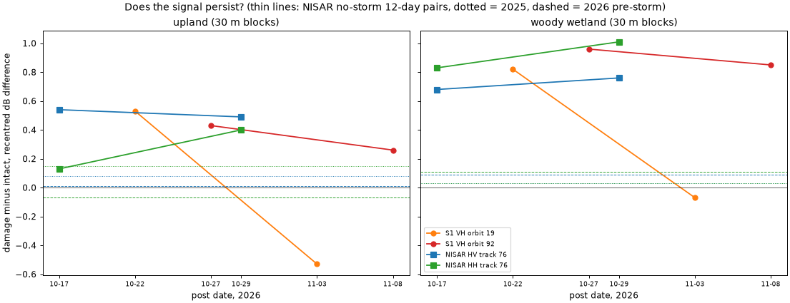

# NISAR no-storm controls, upland scoring and persistence

Branch `pipeline`; extends [pipeline.md](pipeline.md). Same study area, 10 m grid, NISAR invalid-pixel mask (mask 0/255), forest-median re-centring, Sentinel-2 provisional damage mask and labels (block damage ≥ 50%, intact ≥ 90%) as pipeline.md.

Scripts:
- [control_search.py](../../scripts/control_search.py)
- [stack_build.py](../../scripts/stack_build.py), now called with `data/control_granules.json`
- [controls_ee.py](../../scripts/controls_ee.py)
- [controls_eval.py](../../scripts/controls_eval.py)
- [controls_upland.py](../../scripts/controls_upland.py)
- [controls_tables.py](../../scripts/controls_tables.py)

Numbers: [controls_eval.json](controls_eval.json), [controls_upland.json](controls_upland.json), [controls_tables.md](controls_tables.md).

## Summary

**How much is the storm.** At 100 m the storm pair scores HV AUC 0.828. The two no-storm 12-day pairs score 0.566 (2025, same season) and 0.543 (2026, pre-storm). The difference is significant against both controls (block-bootstrap CIs +0.21 to +0.32 and +0.21 to +0.36).
- Of the AUC above 0.5, about 80–87% comes from the storm; the rest is a background floor that appears with no storm.
- In dB terms the damage-minus-intact contrast is +0.54 dB on upland and +0.68 dB in woody wetland. The controls give +0.01 to +0.09 dB.

**Upland forest.** The HV signal holds there, at lower strength: 0.765 against 0.582 / 0.514 at 100 m, and 0.620 against 0.529 / 0.505 at 30 m. All four CIs exclude zero. HH carries no storm signal on upland forest: the 2025 no-storm HH pair separates damage from intact as well as the storm pair does.

**Structural or wet.** On upland forest the NISAR HV contrast is steady from 10-17 to 10-29 (+0.54 → +0.49 dB) and shows up in HV only. That fits structural damage better than a wetness pulse.

In woody wetland the NISAR contrasts grow from 10-17 to 10-29 instead of fading: HV +0.68 → +0.76, HH +0.83 → +1.01. The signal is strongest in HH. This is not a short-lived wetness pulse. But an HH-led signal that grows is also what longer inundation (trunk–water double bounce) would look like. These data can't separate it from structural damage there.

Sentinel-1 doesn't follow the expected wetness pattern either:
- Orbit 92 fades more on upland (+0.43 → +0.26) than in woody wetland (+0.96 → +0.85).
- Orbit 19's 11-03 date flips sign in both domains. That looks like something about that acquisition, not a gradual fade. Not verified.

**Bottom line:** most of the NISAR HV signal is the storm. It survives on upland forest, and there it looks structural. In woody wetland, structural damage and wetness are still confounded.

## Step 1: control scenes (track 76, frame 17, ascending, `_PR_`)

| Date | Granule processor | Spec | Role | Download | Valid share of grid | Forest median HV / HH (dB)* |
|---|---|---|---|---|---|---|
| 2025-10-22 | **X05009** ⚠ | **1.4.0** ⚠ | Control B pre | 6.17 GB, 14.7 min | 0.877 | −11.57 / −5.13 |
| 2025-11-03 | **X05009** ⚠ | **1.4.0** ⚠ | Control B post | 6.18 GB, 14.7 min | 0.888 | −12.09 / −5.55 |
| 2026-09-11 | P05023 | 1.5.0 | Control C pre | 6.01 GB, 14.0 min | 0.855 | −9.44 / −4.00 |
| 2026-09-23 | P05023 | 1.5.0 | Control C post (already extracted) | n/a | n/a | −9.61 / −4.15 |
| 2026-10-05 | P05023 | 1.5.0 | Storm A pre | n/a | n/a | −8.82 / −3.48 |
| 2026-10-17 | P05023 | 1.5.0 | Storm A post | n/a | n/a | −9.78 / −4.24 |
| 2026-10-29 | P05036 ⚠ | 1.6.0 | Persistence post | n/a | n/a | −10.41 / −5.28 |

\*Forest median on 977,967 100 m forest blocks valid in all seven scenes.

**Processor flag.** Both 2025 scenes come from an older processor (X05009, spec 1.4.0) than the storm scenes (P05023, spec 1.5.0). They also sit about 2 dB lower in forest-median HV than any 2026 scene.
- I can't tell whether that's calibration or season. Re-centring removes any uniform offset, so AUC and the contrasts are unaffected by it.
- A non-uniform calibration difference was not checked.

All three new scenes:
- landed on the grid with no lattice shift;
- were extracted to compact HH/HV files of about 0.79 GB each;
- had their raw files deleted.

## Step 2: storm vs no-storm 12-day pairs

- A = 2026-10-05 → 10-17 (storm)
- B = 2025-10-22 → 11-03 (no storm)
- C = 2026-09-11 → 09-23 (no storm)

The 10 m scores use the same stratified pixel sample as evaluate.py. Rebuilding the four-scene headline with this code reproduces `auc.json` exactly (track 76 HV: 0.582 / 0.686 / 0.851).

Deciduous forest has 23 damage blocks at 100 m, too few to score (n/a).

**All forest, AUC**

| Pol | Res (m) | Forest type | A storm | B 2025 | C 2026 pre | A − B | A − C | n damage |
|---|---|---|---|---|---|---|---|---|
| HV | 10 | all | 0.568 | 0.511 | 0.502 | +0.057 | +0.066 | 1,409,947 |
| HV | 10 | evergreen | 0.551 | 0.513 | 0.495 | +0.038 | +0.056 | 652,306 |
| HV | 10 | deciduous | 0.542 | 0.496 | 0.490 | +0.046 | +0.052 | 1,188 |
| HV | 10 | woody wetland | 0.562 | 0.507 | 0.504 | +0.055 | +0.058 | 692,006 |
| HV | 30 | all | 0.656 | 0.527 | 0.514 | +0.129 | +0.142 | 753,395 |
| HV | 30 | evergreen | 0.615 | 0.532 | 0.495 | +0.083 | +0.120 | 343,623 |
| HV | 30 | deciduous | 0.647 | 0.519 | 0.483 | +0.128 | +0.164 | 572 |
| HV | 30 | woody wetland | 0.650 | 0.510 | 0.523 | +0.140 | +0.127 | 375,233 |
| HV | 100 | all | **0.828** | 0.566 | 0.543 | **+0.262** | **+0.285** | 60,378 |
| HV | 100 | evergreen | 0.760 | 0.583 | 0.497 | +0.177 | +0.263 | 26,884 |
| HV | 100 | woody wetland | 0.839 | 0.506 | 0.568 | +0.333 | +0.271 | 31,084 |
| HH | 10 | all | 0.551 | 0.521 | 0.499 | +0.030 | +0.052 | 1,409,947 |
| HH | 10 | evergreen | 0.516 | 0.526 | 0.490 | −0.010 | +0.026 | 652,306 |
| HH | 10 | deciduous | 0.551 | 0.492 | 0.513 | +0.059 | +0.038 | 1,188 |
| HH | 10 | woody wetland | 0.570 | 0.508 | 0.507 | +0.062 | +0.063 | 692,006 |
| HH | 30 | all | 0.604 | 0.553 | 0.504 | +0.051 | +0.100 | 753,395 |
| HH | 30 | evergreen | 0.522 | 0.565 | 0.478 | −0.043 | +0.044 | 343,623 |
| HH | 30 | deciduous | 0.642 | 0.530 | 0.516 | +0.112 | +0.126 | 572 |
| HH | 30 | woody wetland | 0.661 | 0.512 | 0.530 | +0.149 | +0.131 | 375,233 |
| HH | 100 | all | 0.680 | 0.620 | 0.522 | +0.060 | +0.158 | 60,378 |
| HH | 100 | evergreen | 0.529 | 0.651 | 0.461 | −0.122 | +0.068 | 26,884 |
| HH | 100 | woody wetland | 0.792 | 0.506 | 0.586 | +0.286 | +0.206 | 31,084 |

**Block bootstrap of A minus control** (10 km tiles; 150 draws at 30 m, 300 at 100 m)

| Comparison | Pol | Res | Domain | AUC A | AUC control | A − control | 95% CI |
|---|---|---|---|---|---|---|---|
| A − B | HV | 30 m | all | 0.656 | 0.527 | +0.129 | +0.107 to +0.147 |
| A − C | HV | 30 m | all | 0.656 | 0.514 | +0.142 | +0.116 to +0.180 |
| A − B | HH | 30 m | all | 0.604 | 0.552 | +0.052 | +0.016 to +0.084 |
| A − C | HH | 30 m | all | 0.604 | 0.504 | +0.099 | +0.064 to +0.139 |
| A − B | HV | 100 m | all | 0.828 | 0.564 | +0.264 | +0.205 to +0.320 |
| A − C | HV | 100 m | all | 0.828 | 0.543 | +0.285 | +0.205 to +0.362 |
| A − B | HH | 100 m | all | 0.680 | 0.616 | +0.064 | −0.016 to +0.140 |
| A − C | HH | 100 m | all | 0.680 | 0.521 | +0.158 | +0.092 to +0.227 |

(The control AUCs in the bootstrap table differ slightly from the main table because the bootstrap uses only blocks valid in both pairs.)

**Checks**
- **Labels without the 2025 optical term** (100 m, as in matched_check.py): A HV 0.828 → 0.854, B HV 0.566 → 0.585, B HH 0.620 → 0.633, C unchanged. The B floor is not an artefact of the label using 2025 data.
- **Other 12-day pairs, HV, all forest:**
  - Pre-pre 09-23 → 10-05: AUC 0.454 at 100 m. Damage areas got relatively darker, and 10-05 is 0.8 dB brighter overall. Pair A uses 10-05 as its pre scene, so A may be slightly inflated.
  - The earlier sensitivity run gave 0.835 and 0.836 for the stack with either pre scene alone. So this doesn't change the conclusion.
  - Post-post 10-17 → 10-29: 0.544.

## Step 3: upland forest only

Upland means NLCD evergreen or deciduous with MERIT Hydro HAND above 5 m. HAND was pulled at 30 m (nearest neighbour from about 90 m) and repeated to 10 m. Upland blocks use the share of damage-and-upland (or intact-and-upland) 10 m pixels with the usual 50% / 90% thresholds.

- Upland forest: 4,517 km² of 9,512 km² (47%).
- **Damage mask in upland: 245.5 km² of 756.8 km² (32%).** The other 68% is woody wetland, mixed forest, or low-HAND pine.

**Step 2 pairs on upland only, AUC.** By construction upland is almost all evergreen. Deciduous has 398 damage blocks at 30 m and 10 at 100 m.

| Pol | Res (m) | A storm | B 2025 | C 2026 pre | A − B (95% CI) | A − C (95% CI) | n damage |
|---|---|---|---|---|---|---|---|
| HV | 10 | 0.552 | 0.511 | 0.500 | +0.041 | +0.052 | 454,414 |
| HV | 30 | 0.620 | 0.529 | 0.505 | +0.091 (+0.065 to +0.114) | +0.115 (+0.067 to +0.159) | 234,255 |
| HV | 100 | **0.765** | 0.582 | 0.514 | **+0.183** (+0.127 to +0.242) | **+0.251** (+0.130 to +0.347) | 15,687 |
| HH | 10 | 0.519 | 0.524 | 0.494 | −0.005 | +0.025 | 454,414 |
| HH | 30 | 0.528 | 0.561 | 0.487 | −0.033 (−0.068 to +0.002) | +0.041 (+0.003 to +0.087) | 234,255 |
| HH | 100 | 0.535 | 0.653 | 0.474 | −0.118 (−0.208 to −0.027) | +0.061 (−0.037 to +0.143) | 15,687 |

Upland deciduous at 30 m: HV A 0.667 / B 0.497 / C 0.510; HH A 0.677 / B 0.514 / C 0.509. That's only 398 damage blocks, so treat it as indicative.

**Main pipeline table on upland: NISAR HV stack vs S1 VH stack with October-only posts.** The S1 posts are orbit 19 10-22 and orbit 92 10-27. S1 at 30 m comes from new per-date pulls; at 100 m from `s1_perdate_100.npz`. The all-forest 100 m rows reproduce matched_check.json (0.795 and 0.809).

| NISAR arm | Res | Domain | AUC NISAR | AUC S1 Oct | NISAR − S1 | 95% CI (block) | n damage |
|---|---|---|---|---|---|---|---|
| Both tracks | 30 m | all | 0.647 | 0.640 | +0.007 | −0.009 to +0.022 | 794,499 |
| Track 76 | 30 m | all | 0.686 | 0.648 | +0.038 | +0.025 to +0.051 | 759,635 |
| Both tracks | 30 m | **upland** | 0.571 | 0.591 | −0.020 | −0.035 to −0.004 | 248,355 |
| Track 76 | 30 m | **upland** | 0.638 | 0.603 | +0.035 | +0.018 to +0.053 | 236,088 |
| Both tracks | 100 m | all | 0.786 | 0.795 | −0.009 | −0.032 to +0.009 | 62,818 |
| Track 76 | 100 m | all | 0.851 | 0.809 | +0.042 | +0.021 to +0.060 | 60,809 |
| Both tracks | 100 m | **upland** | 0.656 | 0.706 | **−0.050** | −0.087 to −0.018 | 16,506 |
| Track 76 | 100 m | **upland** | 0.770 | 0.729 | **+0.041** | +0.009 to +0.072 | 15,780 |

On upland the pattern from pipeline.md gets sharper:
- Track 76 still beats date-matched S1 by about 0.04.
- The two-track NISAR average now loses to S1, because track 55 is weak in pine.

## Step 4: does the signal persist?

Contrast here means the recentred dB difference averaged over damage blocks minus the average over intact blocks, at 30 m.
- S1 VH: each post date against that orbit's pre-storm average. For orbit 19 that's 09-28; for orbit 92 it's the mean of 09-21 and 10-03.
- NISAR: post date against 10-05.

| Series | Upland | Woody wetland |
|---|---|---|
| NISAR HV, post 10-17 | +0.54 | +0.68 |
| NISAR HV, post 10-29 | +0.49 | +0.76 |
| NISAR HH, post 10-17 | +0.13 | +0.83 |
| NISAR HH, post 10-29 | +0.40 | +1.01 |
| S1 VH orbit 19, post 10-22 | +0.53 | +0.82 |
| S1 VH orbit 19, post 11-03 | −0.53 | −0.07 |
| S1 VH orbit 92, post 10-27 | +0.43 | +0.96 |
| S1 VH orbit 92, post 11-08 | +0.26 | +0.85 |
| NISAR HV no-storm B (2025) / C (2026 pre) | +0.08 / +0.01 | +0.03 / +0.09 |
| NISAR HH no-storm B (2025) / C (2026 pre) | +0.15 / −0.07 | +0.03 / +0.11 |

At 100 m the values are within 0.06 dB of these ([controls_upland.json](controls_upland.json)).

As AUC, the NISAR HV storm signal is just as strong at 10-29 as at 10-17: 10-05 → 10-29 scores 0.823 at 100 m, against 0.828 for 10-05 → 10-17.

**Salvage after 10-29.** I compared Sentinel-2 SCL-masked medians for 10-11..10-29 and 10-30..11-10 at 30 m. Clearing-like means NDVI after 10-29 below 0.35 and a drop of more than 0.15.
- Damage blocks: 2.46 km² clearing-like, 0.34% of damage blocks.
- Intact blocks: 0.04 km².
- Forest pixels had 3.6 clear Sentinel-2 looks on average after 10-29.

Some salvage-like clearing has started inside the damage mask, but too little to move any number here.

## Disk and time

| Item | Size / time |
|---|---|
| 3 NISAR granules downloaded, one at a time | 18.4 GB, 43 min; raw files deleted |
| Compact control files in data/stack | 2.36 GB (data/stack now 8.4 GB) |
| Earth Engine pull (HAND, 7 S1 dates, S2 composites at 30 m) | 39 min (S2 alone 28 min) |
| controls_eval.py | 13 min |
| controls_upland.py | not timed (a few minutes) |
| Free disk | 645.0 GB at start, 641.6 GB after the downloads, about 639 GB now; never near the 15 GB floor |

Not touched:
- `data/layers.h5`
- NISAR frames 18 and 72 (not downloaded)
- the remote (nothing pushed)

## Not verified

- **2025 calibration.** The 2025 control scenes are X05009 / spec 1.4.0 and about 2 dB darker in forest-median HV than 2026. Only uniform offsets are removed by re-centring; a non-uniform difference between processor versions was not checked. The 2025 HH pair's upland AUC of 0.653 is not explained.
- **The 10-29 scene is P05036.** It sits about 0.6 dB (HV) and 1 dB (HH) lower overall, so the growth in HH contrast to 10-29 could partly be processing rather than ground change.
- **Orbit 19's 11-03 sign flip.** Its cause wasn't checked; candidates are rain at acquisition time and a sensor or processing issue.
- **Inundation vs structure in woody wetland** can't be separated with these data. No water-level or flood-extent data were used.
- **Upland mask quality.** MERIT HAND is about 90 m and predates 2026. The 5 m threshold is the spec's, not tuned.
- **The damage reference is still Sentinel-2 based** and provisional. There's no aerial or field truth inside the band.
- **Salvage counts** are 30 m Sentinel-2 composites over about 12 days. Clearing smaller than 30 m, or under cloud in every look, would be missed.
