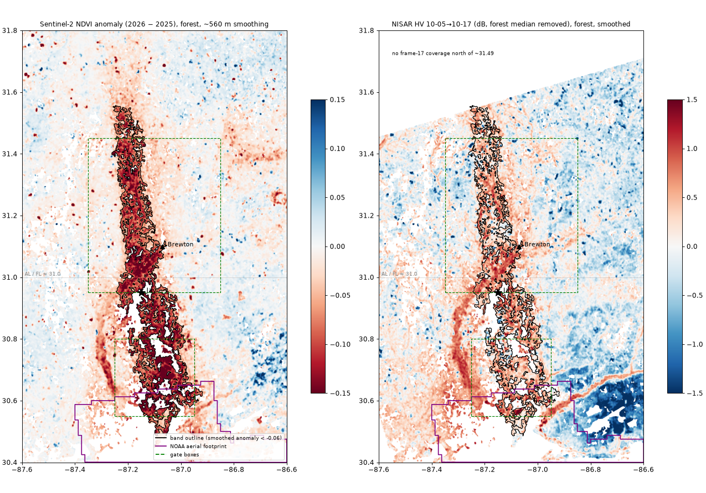

# Where does the band go? (pipeline step 1)

Inputs:
- **Sentinel-2 NDVI anomaly:** 2026 change minus 2025 change for the same weeks. Each change is the post composite (10-11→11-09) minus the pre composite (09-01→10-08), using cloud-, shadow- and water-masked median composites.
- **NISAR HV change** from the two gate scenes (track 76 frame 17, 10-05→10-17). It's averaged in linear power to 80 m blocks, then put on the same 0.0008° grid, with the forest median removed.
- **Forest:** NLCD 2025 classes 41/42/43/90. Pixels with dNDVI < −0.5 (open water or flooding) are excluded.
- **Band outline:** forest anomaly smoothed over ~560 m, threshold < −0.06, keeping the connected region that contains the gate band.

Scripts: `extent_ee.py`, `extent_nisar.py`, `extent_noaa.py`, `extent_analysis.py`. Numbers: [extent.json](extent.json).

## North–south extent

- **The band is continuous from lat 30.49 to 31.56**, about 120 km. Its lon is about −87.25 to −87.05 north of 31.0, and it widens to −87.20 to −86.92 in Florida.
  Area: 1,035 km², of which 699 km² is forest.
- **Northern end:** the outline stops at 31.56. North of that the anomaly contrast falls to 0.04–0.06, against 0.10–0.19 inside the band. It looks like it fades out, not a sharp end. NISAR frame 17 can only confirm up to about 31.49.
- **Southern end:** around 30.49 it reaches open water and urban Milton/Pace, where non-forest and water are masked out.
- **Yes, it continues into Florida between 30.80 and 30.95, with no break across the state line.**

| Lat strip | Band lon range | Band width (km) | Anomaly contrast vs strip median | NISAR HV, band − other forest (dB) |
|---|---|---|---|---|
| 31.50–31.55 | −87.25 to −87.16 | 7.8 | 0.08 | +0.49 (frame covers 69%) |
| 31.20–31.25 | −87.23 to −87.11 | 11.7 | 0.11 | +0.65 |
| 31.05–31.10 | −87.21 to −87.06 | 14.1 | 0.18 | +0.77 |
| 31.00–31.05 | −87.23 to −87.08 | 14.0 | 0.19 | +0.71 |
| **30.95–31.00** | −87.24 to −87.05 | 18.9 | 0.15 | +0.66 |
| **30.90–30.95** (Jay) | −87.24 to −87.01 | 20.9 | 0.19 | +0.53 |
| **30.85–30.90** | −87.22 to −87.01 | 16.1 | 0.15 | +0.56 |
| **30.80–30.85** | −87.20 to −86.99 | 19.1 | 0.18 | +0.46 |
| 30.70–30.75 | −87.19 to −86.98 | 20.2 | 0.20 | +0.41 |
| 30.60–30.65 | −87.15 to −86.92 | 22.2 | 0.17 | +0.69 |
| 30.50–30.55 | −87.13 to −87.02 | 10.5 | 0.15 | +0.54 |

The full 0.05° strip table is in extent.json. North of 31.56 no strip passes the outline threshold.

Across the whole band, NISAR HV is **+0.58 dB** higher than other forest, and HH is +0.22 dB. NISAR covers 95% of the band.

## Overlap with the NOAA aerial footprint

- Inside the study box the NOAA footprint (1,069 tiles, dissolved) covers 1,474 km², but **only south of lat ~30.66**. It is a coastal strip.
  Forest inside the footprint: 500 km².
- **Band ∩ aerial footprint: 121 km², of which 67.7 km² is forest.** That's the southern tip of the band (lat 30.49–30.66, around Milton/Pace), about 10% of the band's forest.
  There is no aerial imagery for the band's core (31.0–31.5) or for the Jay section.

## NISAR frame coverage

- **Track 76 frame 17** (the gate scenes) misses the **northern wedge, lat ~31.49–31.80**: 13% of the study box, plus a 0.1% sliver at the SW corner.
  **Frame 18** on track 76 covers it (`…_076_A_018_…`, about 7.0 GB per scene). Not downloaded; that needs your OK.
- **Track 55 frame 73** (descending, in the step-2 stack) misses the **NE corner, lat 31.67–31.80, east of lon −87.13** (2.5%).
  **Frame 72** on track 55 covers it (about 7.1 GB per scene). Not downloaded.
- The band's northern end (31.49–31.56) falls in the frame-17 gap but inside frame 73. The descending stack will cover it.

## Not verified

- **What causes the band.** Its outline follows a drainage-like, branching pattern, and there's a second, narrower linear feature to the west (lon −87.35 to −87.25, lat 30.5–30.95) that also shows in NISAR but falls below the threshold or isn't connected.
  Woody wetland makes up 39% of forest inside the band against 27% across the box, so the band is enriched in floodplain forest. Evergreen is 58% against 65%.
  Wind damage concentrated in river bottoms, and storm flooding, both fit this. The gate's HH check argued against standing water on 10-17, but I haven't checked a river or flood dataset here.
- **The −0.06 threshold** is a judgment call, calibrated by eye against the gate band. The band's area depends on it.
- **The large negative NISAR HV area in the SE** (east of −86.9, south of 30.7) isn't interpreted. It's outside the band.
