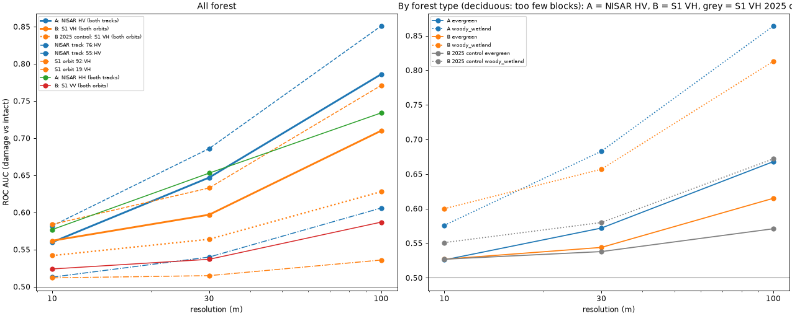
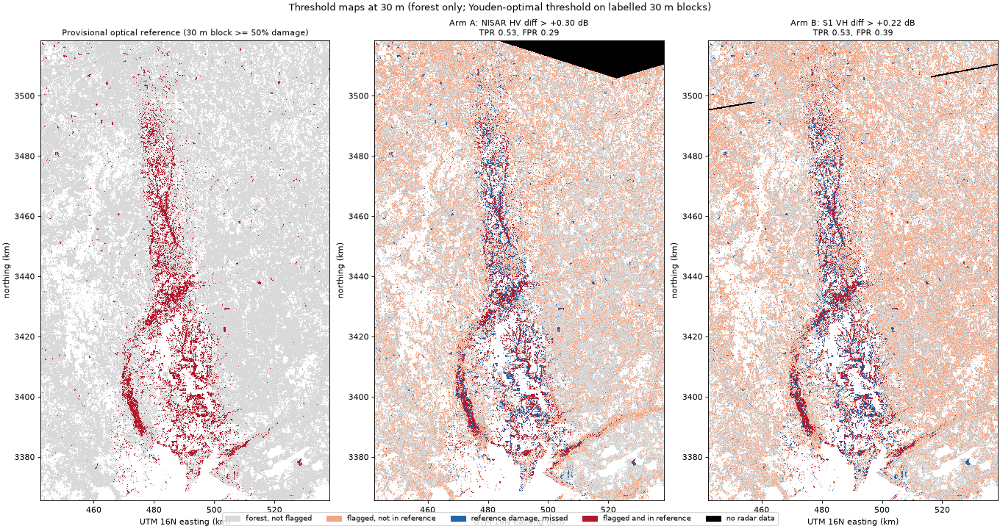
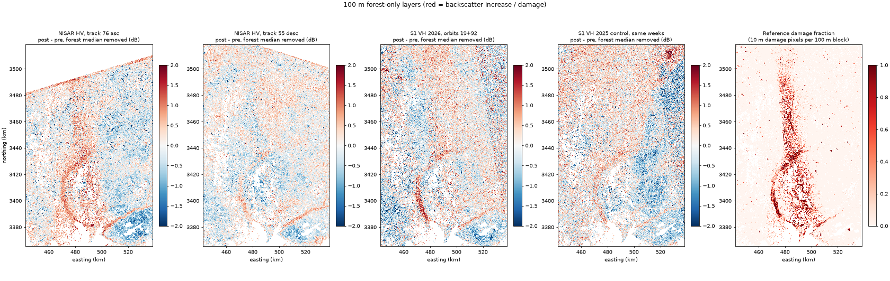

# Blowdown pipeline: NISAR vs Sentinel-1 over the Isaias band (study area −87.60 to −86.60, 30.40 to 31.80)

**Answer: with the dates as specified and both stack-averaged, NISAR L-band HV separates the optical damage band from intact forest better than Sentinel-1 C-band VH at 30 m and 100 m. At 10 m it does not: both are near chance.**

**This lead is partly a date effect.** The specified S1 posts run to 11-08, while NISAR's end on 10-29. If S1 also uses October posts only, the two-geometry average **ties** NISAR at 100 m. **NISAR's ascending track 76 still beats every S1 option.**

| Resolution | AUC, NISAR HV (both tracks) | AUC, S1 VH (both orbits) | A − B | 95% CI (10 km block bootstrap) |
|---|---|---|---|---|
| 10 m | 0.560 | 0.563 | −0.002 | −0.006 to +0.001 (pixel bootstrap) |
| 30 m | 0.647 | 0.597 | **+0.050** | +0.029 to +0.061 |
| 100 m | 0.786 | 0.710 | **+0.076** | +0.043 to +0.106 |
| 100 m, S1 posts October only (o19 10-22, o92 10-27) | 0.786 | 0.795 | −0.009 | −0.031 to +0.012 |
| 100 m, NISAR track 76 vs S1 October-only (both orbits) | 0.851 | 0.809 | **+0.042** | +0.023 to +0.062 |
| 100 m, NISAR track 76 vs S1 orbit 92 October-only | 0.856 | 0.781 | **+0.075** | +0.052 to +0.103 |

The date-matched rows use S1 per-date VH aggregated to 100 m in Earth Engine. The same file with the specified dates reproduces arm B exactly (0.710).
Source: [matched_check.json](matched_check.json). No date-matched check was run at 30 m.

Qualifications:
1. **The NISAR lead comes from track 76 (ascending).** Track 76 HV reaches 0.851 at 100 m. Track 55 (descending) reaches only 0.606, which is below Sentinel-1 orbit 92 (0.771).
2. **The C-band damage signal is short-lived.** Orbit 19 scores 0.736 for 09-28→10-22 but 0.384 for 09-28→11-03, so averaging in 11-03 drops it to 0.536.
   NISAR has no scene after 10-29, so whether L-band also fades is untested. Its 10-17-only post scored 0.842 and the 10-17 + 10-29 average scored 0.851.
3. **The no-storm floor is not 0.5.** Sentinel-1 VH for the same weeks of 2025, scored against the 2026 labels, gets AUC 0.628 at 100 m (0.672 in woody wetland).
   This is not because the label uses 2025 NDVI. With a label that leaves out the 2025 term, the control rises to 0.671 (evergreen 0.597, woody wetland 0.708).
   It's a land-cover/backscatter-change pattern that tracks where the band is: damage is 48% woody wetland and intact is 20%.
   **NISAR has no stacked 2025 control** (track 76 GCOV starts 2025-10-22). Single 12-day no-storm pairs were added later: the storm pair scores HV 0.828 at 100 m against 0.543 and 0.566 for the no-storm pairs (see [controls.md](controls.md)).
4. **Within forest type, NISAR still leads at 100 m.**
   - Evergreen: NISAR 0.668, S1 0.615, 2025 control 0.571.
   - Woody wetland: NISAR 0.864, S1 0.813, 2025 control 0.672.
   These use the specified S1 dates, not date-matched.
5. **The reference is provisional and optical.** It is not aerial or field truth (Step 4).
   With the label that leaves out 2025, every arm scores a little higher and the specified-dates lead is +0.087 (CI +0.064 to +0.111).

## Step 1: band extent

See [extent.md](extent.md). In brief:
- The band runs continuously from lat 30.49 to 31.56, about 120 km. It covers 1,035 km², 699 km² of which is forest.
- It continues into Florida across 30.80–30.95 with no break.
- Overlap with the NOAA aerial footprint is 121 km², 67.7 km² of it forest. That is only the southern tip, lat 30.49–30.66.
- Track 76 frame 17 misses lat 31.49–31.80; frame 18 would cover it. Track 55 frame 73 misses the NE corner; frame 72 would cover it. Neither was downloaded.

## Inputs

| Arm | Geometry | Pre | Post | Notes |
|---|---|---|---|---|
| A: NISAR GCOV `_PR_` | Track 76 frame 17, ascending (~06:02 local) | 2026-09-23, 10-05 | 10-17, 10-29 | 10-29 is processor **P05036 / spec 1.6.0**; the others are P05023 / 1.5.0. The study area is 85–87% inside the frame. |
| A: NISAR GCOV `_PR_` | Track 55 frame 73, descending (~19:37 local) | 09-22, 10-04 | 10-16, 10-28 | 10-28 is P05036 / 1.6.0. The study area is 93–97% inside the frame. |
| B: Sentinel-1D GRD (EE `S1_GRD_FLOAT`, IW, ascending) | Orbit 19 | 09-28 (only pre date on this orbit) | 10-22, 11-03 | Covers 73% of the area. |
| B: Sentinel-1D GRD | Orbit 92 | 09-21, 10-03 | 10-27, 11-08 | Covers 89%. |
| B 2025 control: Sentinel-1A | Orbits 19 / 92 | 2025-09-26 / 09-19, 10-01 | 10-20, 11-01 / 10-25, 11-06 | Same weeks, no storm. |
| Optical reference: S2 SR harmonized, SCL-masked medians | n/a | 09-01→10-09 (and 08-01→09-11 "early") | 10-11→11-10 | 2025 same weeks for the anomaly. Land cover is NLCD 2025. |

The requested S1 dates split across the two orbits (the date→orbit check is in `data/s1_stack_check.json`). 10-10 is excluded, as requested.

**Processing:**
- **Grid:** one common 10 m UTM 16N grid, 9,607 × 15,533 px. NISAR is natively on this lattice (shift 0 m for all 8 scenes). Sentinel-1 and Sentinel-2 are pulled onto it through Earth Engine.
- **NISAR masking:** mask values 0 and 255 are set to NaN.
- **Sentinel-1 masking:** power ≤ 0 is set to NaN, and the swath edges are trimmed by 200 m. Zero-power pixels occurred along the S1D swath edge plus scattered interior pixels (about 0.02% of forest).
- **Stacking:** for each track or orbit, pre and post scenes are averaged in linear power, then converted to dB. The output is pre, post, diff and diff recentred on the forest median.
- **Forest-median offsets removed:**

| NISAR arm | HH | HV |
|---|---|---|
| Track 76 | −0.87 dB | −0.84 dB |
| Track 55 | −0.39 dB | −0.48 dB |

| Sentinel-1 VH | 2026 | 2025 |
|---|---|---|
| Orbit 19 | +0.72 dB | −1.05 dB |
| Orbit 92 | −0.71 dB | −0.36 dB |

## Step 4: provisional optical reference

| Class (forest = NLCD 41/42/43/90) | km² |
|---|---|
| Forest in study area | 9,553 |
| **Damage**: dNBR < −0.10 and NDVI anomaly (2026 change − 2025 change) < −0.06 | **758** (evergreen 349, woody wetland 362, mixed 46, deciduous 1.6) |
| **Intact**: dNBR > −0.03 and anomaly > −0.02 | 5,389 (evergreen 3,968, woody wetland 1,074, mixed 335, deciduous 12) |
| Clearcut/salvage flag, excluded from both classes | 168 |
| …loss began before 10-09 (pre NDVI < 0.45, or early − pre > 0.15) | 168.1 |
| …near-total loss in rectangular patches (≥ 0.5 ha, bbox fill ≥ 0.6) | 0.1 (7 patches) |

Numbers: [reference.json](reference.json).

- The damage class reproduces the Step 1 band (left panel of the threshold maps below).
- **The rectangle test caught almost nothing.** Only 7 of 5,131 near-total patches passed. But near-total loss inside the damage class is just 5.5 km². Removing the 1,617 damage blocks at 100 m that contain ≥ 5% near-total pixels *raises* every AUC by about 0.01–0.02 (A 0.802, B 0.724).
- **Deciduous (NLCD 41) is 33 km² in total.** That's 60 damage blocks at 100 m (23 for track 76), so deciduous is **not assessable**.
- Mixed forest (746 km²) is in "all forest" but not broken out.

## Step 5: maps and numbers

### Threshold maps (30 m)

Each map uses the Youden-optimal threshold on labelled 30 m blocks. Arm A is NISAR HV > +0.30 dB (TPR 0.53, FPR 0.29). Arm B is S1 VH > +0.22 dB (TPR 0.53, FPR 0.39). TPR and FPR are in-sample: the threshold was chosen on the same blocks it is scored on.

Both arms trace the band. NISAR gives fewer false alarms in the surrounding pine.

At 30 m both maps are still noisy; neither would make a usable damage map at this resolution without spatial filtering.

### 100 m layers

- The 2025 Sentinel-1 control has no band. It does show broad east–west patterns, which are part of why its AUC is above 0.5.
- In track 76, the SE corner (south of 3,390 km, east of 500 km) shows a strong negative change. It is outside the band and isn't interpreted.

### Per-geometry and per-polarization (all forest; full tables with dB mean ± sd for every arm, resolution and forest type in [auc_table.md](auc_table.md))

| Arm | AUC 10 m | AUC 30 m | AUC 100 m | Δ dB at 30 m, damage − intact (damage sd / intact sd) |
|---|---|---|---|---|
| NISAR HV, both tracks | 0.560 | 0.647 | **0.786** | +0.37 (0.98 / 0.74) |
| NISAR HH, both tracks | 0.577 | 0.653 | 0.734 | +0.51 (1.06 / 0.86) |
| NISAR HV, track 76 asc | 0.582 | 0.686 | **0.851** | +0.69 (1.25 / 0.97) |
| NISAR HV, track 55 desc | 0.513 | 0.540 | 0.606 | +0.12 (1.20 / 0.95) |
| NISAR HH, track 76 | 0.576 | 0.654 | 0.754 | +0.65 |
| NISAR HH, track 55 | 0.546 | 0.600 | 0.671 | +0.42 |
| S1 VH, both orbits | 0.562 | 0.597 | **0.710** | +0.42 (1.35 / 1.27) |
| S1 VV, both orbits | 0.524 | 0.537 | 0.587 | +0.16 |
| S1 VH, orbit 92 | 0.584 | 0.633 | 0.771 | +0.66 (1.56 / 1.37) |
| S1 VH, orbit 19 | 0.512 | 0.515 | 0.536 | +0.08 |
| **S1 VH 2025 control**, both orbits | 0.542 | 0.564 | 0.628 | +0.28 |

How to read the table:
- **Δ dB:** the damage − intact difference is similar for the two sensors (+0.37 vs +0.42 dB at 30 m). NISAR wins because its spread is smaller: intact sd is 0.74 dB vs 1.27 dB for Sentinel-1 at 30 m, and 0.33 vs 0.56 dB at 100 m.
- **10 m:** with 2 + 2 scenes per stack, speckle (sd about 1.7–1.8 dB) swamps a 0.3–0.4 dB shift.

### By forest type (AUC; deciduous not assessable)

| Arm | Evergreen 10 / 30 / 100 m | Woody wetland 10 / 30 / 100 m |
|---|---|---|
| NISAR HV, both tracks | 0.526 / 0.572 / **0.668** | 0.576 / 0.683 / **0.864** |
| S1 VH, both orbits | 0.527 / 0.544 / 0.615 | 0.600 / 0.657 / 0.813 |
| S1 VH 2025 control | 0.527 / 0.538 / 0.571 | 0.551 / 0.580 / 0.672 |
| NISAR HV, track 76 | 0.560 / 0.637 / 0.775 | 0.583 / 0.692 / 0.888 |
| NISAR HV, track 55 | 0.483 / 0.471 / **0.456** | 0.531 / 0.579 / 0.691 |
| S1 VH, orbit 92 | 0.551 / 0.583 / 0.688 | 0.613 / 0.678 / 0.846 |

Track 55 HV goes the wrong way in evergreen pine: damaged pine shows *lower* HV than intact pine on the descending pass. I haven't explained this (see Not verified).

## Sensitivity checks ([sensitivity.json](sensitivity.json), [scene_check.json](scene_check.json))

- **Mixed NISAR processor versions.** Both P05036 / spec 1.6.0 scenes sit 0.62–0.64 dB (HV) and 0.97–1.06 dB (HH) below the preceding scene, in forest median.
  The two track-55 pre scenes agree within 0.05–0.1 dB. The offset is nearly uniform: within ±0.1 dB across the area, except track 76 HH, which has about 0.5 dB of east–west slope.
  It could be calibration or drying; I can't tell which. Dropping the P05036 scenes changes HV AUC at 100 m only slightly: 0.786 → 0.784 combined, 0.851 → 0.842 for track 76.
- **Track 76 pre scenes differ by 0.78 dB.** 10-05 is brighter than 09-23. Using either pre scene alone gives HV AUC 0.835 and 0.836 at 100 m, so the track 76 result does not hinge on one pre scene.
- **Sentinel-1 per date (VH, 100 m, AUC / Δ dB):**

| Orbit | Pair | AUC | Δ dB |
|---|---|---|---|
| 19 | 09-28→10-22 | **0.736** | +0.72 |
| 19 | 09-28→11-03 | **0.384** | −0.41 |
| 19 | 10-22→11-03 | 0.194 | −1.13 |
| 92 | 09-21→10-27 | 0.756 | +0.78 |
| 92 | 10-03→10-27 | 0.721 | +0.73 |
| 92 | 09-21→11-08 | 0.718 | +0.63 |
| 92 | 10-03→11-08 | 0.679 | +0.58 |
| 92 | pre→pre 09-21→10-03 | 0.521 | +0.05 |
| 92 | post→post 10-27→11-08 | 0.441 | −0.15 |

  The C-band damage response is strongest about two weeks after the storm and fades or reverses within weeks. That points to moisture (wet debris, standing water in bottomlands) as part of the signal. Orbit 19's 11-03 scene reverses it outright.
  NISAR can't be tested for the same fading: it has no scene after 10-29. The 10-17-only post scored 0.842 and the 10-17 + 10-29 average scored 0.851.
- **Pixel vs spatial bootstrap.** The pixel bootstrap gave CIs of ±0.003. The 10 km block bootstrap gives ±0.02–0.03, which is the honest figure; both are reported above.

## Disk and time

| Item | Value |
|---|---|
| Free disk | 706.1 GB at start, 691.8 GB lowest during the NISAR downloads, about 646 GB at the end (**the lowest point**, after the Earth Engine pulls and layer files). The 15 GB stop never came close. |
| NISAR | 6 new scenes downloaded, 37.0 GB in 4,877 s (81 min, about 7.6 MB/s), one at a time. Each was extracted to compact HH/HV (0.77–0.88 GB, 8 s each), then the raw file was deleted. The 2 gate scenes were reused (raw kept from the gate: 12.2 GB). Peak RAM 0.24 GB. |
| Sentinel-1 EE pulls (10 m) | 2026: 1,035 s; 2025: 1,022 s (77 tiles per orbit); 6.7 GB. Per-date 100 m check: 9 min. |
| Sentinel-2 EE pull (10 m, 8 bands) | 6,168 s (103 min); 2.85 GB |
| Combine / reference / evaluate | About 30 s per arm, 19 s, and 305 s (peak RAM 3.1 GB) |
| `data/` on disk | 62 GB. `layers.h5` is 36 GB of that, inflated by repeated rewrites; it's derived and can be deleted and regenerated with `stack_combine.py`. Compact NISAR 6.6 GB, S1 6.7 GB, S2 2.8 GB, coarse npz 1.5 GB. |
| Wall clock for this pipeline | About 4.5 h (00:38–05:10 for steps 2–6), mostly the NISAR download (81 min) and the S2 pull (103 min) |

## Not verified

- **Truth.** The reference is a heuristic optical mask (dNBR plus NDVI anomaly thresholds), not windthrow observed on the ground or in aerial imagery. The aerial footprint covers only the band's southern tip, and I didn't compare it pixel by pixel.
  The thresholds (−0.10, −0.06, −0.03, −0.02) are judgment calls.
- **What the radar responds to.** The Sentinel-1 signal fades or reverses by early November, and damage is concentrated in woody wetland. Part of both sensors' response may be moisture or flooding in bottomlands rather than structural damage. I haven't checked river gauges, rainfall or a flood product.
- **The NISAR no-storm floor.** ASF metadata shows NISAR GCOV from 2025-10-22 on: track 76 frame 17 has 2025-10-22, 11-03 and 11-15; track 55 frame 73 starts 2025-11-26. So there is no 2025 pre-storm pair.
  Two 12-day no-storm pairs (2025-10-22→11-03 and 2026-09-11→09-23) have since been downloaded and scored in [controls.md](controls.md). The 09-23 scene was reused from its compact file.
  Sentinel-1's floor is 0.63 at 100 m.
- **The P05036 offset** (0.6 dB HV, 1 dB HH): calibration or environment, not resolved.
- **Track 55 HV reversal in evergreen**, and why descending is so much weaker than ascending. Ascending passes at about 06:02 local time (possible dew) and descending at about 19:37. I didn't test this.
- **Orbit 19's 11-03 scene:** not inspected for rain or wet-surface conditions.
- **Stack depth differs.** NISAR has 2 + 2 scenes per track. Sentinel-1 orbit 19 has 1 + 2 and orbit 92 has 2 + 2. The 2025 control is S1A while 2026 is S1D, so a sensor difference is possible.
- **Clearcut/salvage flag.** The rectangle test (axis-aligned bbox fill) is weak: 7 patches passed. Near-total loss inside damage is small (5.5 km²) and removing it doesn't change the conclusion.
- **Frame gaps.** Track 76 doesn't cover lat 31.49–31.80, and track 55 misses the NE corner. Frames 18 and 72 weren't downloaded and need your OK.
- **The 10 m comparison** uses a pixel bootstrap only. Since the AUC difference is −0.002 there, this doesn't change the "tie" reading.
- **The SE negative-change area** in NISAR track 76 isn't interpreted.

## Reproduce

Scripts are in `scripts/`; run them with `.venv/Scripts/python -I`.
1. Step 1: `extent_ee`, `extent_nisar`, `extent_noaa`, `extent_analysis`.
2. Stacks: `stack_search`, `stack_build`, `s1_stack 2026`, `s1_stack 2025`, `s2_stack`.
3. Combine and evaluate: `stack_combine`, `reference`, `scene_check`, `evaluate`, `s1_perdate`, `sensitivity`, `matched_check`, `pipeline_figures`.

`data/` is git-ignored.
