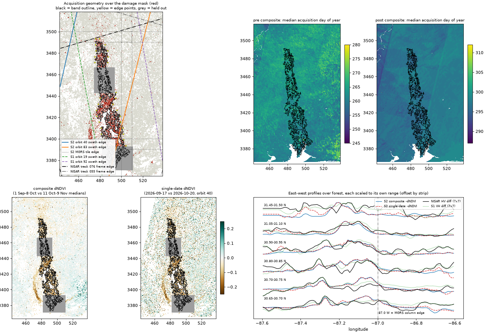

# Artifact check: is the damage band an acquisition artefact?

Branch `site`. The held-out block (lat 31.14–31.32, plus a 2 km buffer) and the aerial tip (plus a 2 km buffer) are masked in every number and in the figure.

Scripts:
- [artifact_inventory.py](../../scripts/artifact_inventory.py)
- [artifact_single.py](../../scripts/artifact_single.py)
- [artifact_check.py](../../scripts/artifact_check.py)
- [artifact_edges.py](../../scripts/artifact_edges.py)

Numbers: [artifact_check.json](artifact_check.json), [artifact_edges.json](artifact_edges.json).

**Answer: no.** Neither edge of the band follows a swath edge, a frame edge or a change in composite acquisition date. The band and both edges survive a rebuild from one clear pre scene and one clear post scene. The tile-free radar sensors put the band in the same place.

## What went into the composites

| Source | Scenes over the study area | Geometry |
|---|---|---|
| Sentinel-2 pre (1 Sep–8 Oct) | 107 granules | relative orbits 40 and 83; MGRS tiles 16RDU, 16RDV, 16REU, 16REV, 16SDA, 16SEA |
| Sentinel-2 post (11 Oct–9 Nov) | 82 granules | same orbits and tiles |
| Sentinel-1 (ascending, IW) | 14 slices | orbit 19 on 28 Sep, 22 Oct and 3 Nov; orbit 92 on 21 Sep, 3 Oct, 27 Oct and 8 Nov |
| NISAR GCOV | 8 frames | track 76 frame 17 and track 55 frame 73, four dates each |

Footprints, dates and orbits are in `data/artifact/inventory.json`.

## Do the band's edges coincide with acquisition boundaries?

The band's west and east edges were taken in each 0.05° latitude strip outside the held-out areas: 29 edge points. For each one, I measured the distance to the nearest boundary:

| Boundary | Median distance | Edge points within 1 km / 3 km |
|---|---|---|
| Sentinel-2 orbit 40 swath edge | 49 km | 0 / 0 |
| Sentinel-2 orbit 83 swath edge | 21 km | 0 / 2 |
| Sentinel-2 MGRS tile edge | 5 km | 3 / 8 |
| Sentinel-1 orbit 19 swath edge | 21 km | 0 / 0 |
| Sentinel-1 orbit 92 swath edge | 39 km | 0 / 0 |
| NISAR track 76 frame edge | 54 km | 1 / 2 |
| NISAR track 55 frame edge | 60 km | 0 / 0 |

The one close match is the **MGRS tile edge**. Between about 30.65°N and 30.95°N, the band's east edge runs within 1–5 km of the column boundary at easting 500,000 m (87.0°W). Three checks say that's a coincidence of position, not a processing artefact:

1. **No step at the tile line where the band is absent.**
   - In the 17 strips where the band doesn't reach 87.0°W, Sentinel-2 change barely moves across the line: median step 0.003 NDVI in the composite (largest 0.015), 0.003 in the single-date difference (largest 0.03).
   - Where the band does reach the line, the step is 0.02, the same size and sign as the band's edge gradient.
2. **The single-date rebuild has the same edge.** Each date is one acquisition across both tiles. Its edge sits within 1 km of the composite's (median shift 0 km on the west edge, 1 km on the east).
3. **Radar has no tiles and agrees.** Per strip, the NISAR HV and Sentinel-1 VH east-west profiles are best aligned with the Sentinel-2 profile at a median shift of 1 km (0.5–1 km in 30.65–30.95°N), with median correlations of 0.53 and 0.70. In the figure's profile panel, both radar profiles drop at the same longitude as Sentinel-2 near 87.0°W.

**No date or count jump across the edges.** Across each edge (2 km outside vs 2 km inside), the composites' median acquisition day and clear-observation count change by a median of 0. Changes of 2 or more occur at 55% (pre date), 62% (pre count), 21% (post date) and 31% (post count) of edge points. Random 4 km east-west pairs anywhere in the scene give 47%, 50%, 12% and 28%. With only 29 edge points, that's within noise.

## Single-date rebuild

- **Scene choice:** the clearest single-date pair on one relative orbit with full coverage of the band box (lon −87.40 to −86.80, lat 30.45–31.60), picked automatically from all 34 date-orbit combinations. That's orbit 40, **17 September 2026** (pre, 96.9% clear) and **20 October 2026** (post, 97.6% clear), the same mask and NDVI as the composites, at 30 m.
- **Band and edges:** both are present. Mean NDVI change inside the damage mask is −0.143 single-date against −0.146 composite. Outside it's −0.011 against −0.001.
- **Proxy agreement:** 74% of damage-mask forest cells pass the single-date change proxy (dNBR < −0.10 and dNDVI < −0.06), against 15% outside.
- **Noise:** the single-date difference is noisier (pixel correlation with the composite r = 0.39; proxy share 18.8% against 8.4%), as expected from two days without a 2025 baseline. The band's position is unchanged.

## Not verified

- **Sentinel-2 processing within a tile** (L2A correction applied per granule) can't be fully ruled out from optical data alone. The radar agreement is the independent check.
- **The arc of greenness loss west of the band's southern half** (about 87.4–87.3°W, 30.5–30.9°N) shows in both the composite and the single-date difference, and in NISAR. It lies outside the band outline and wasn't investigated.
