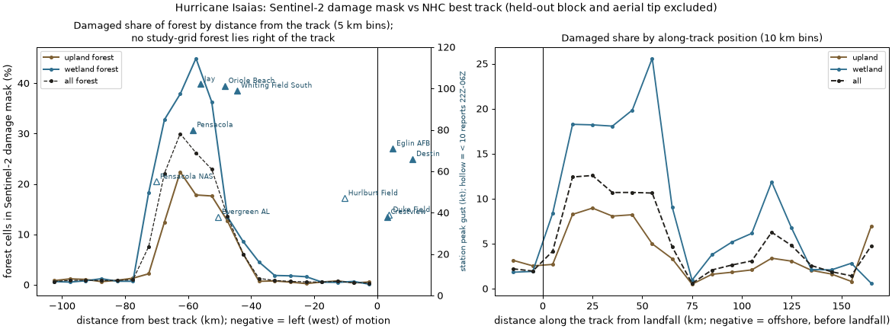
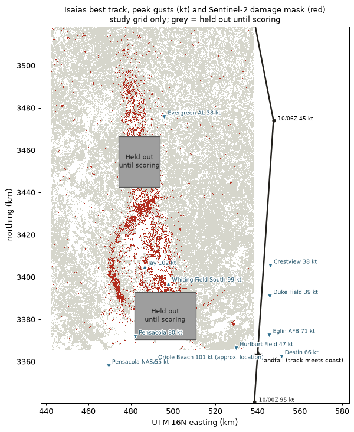
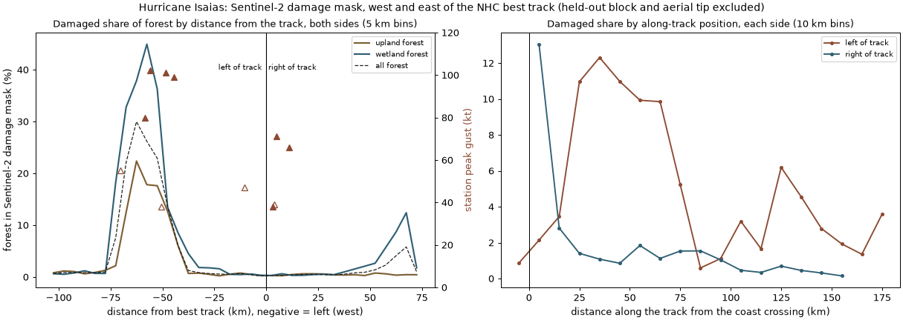
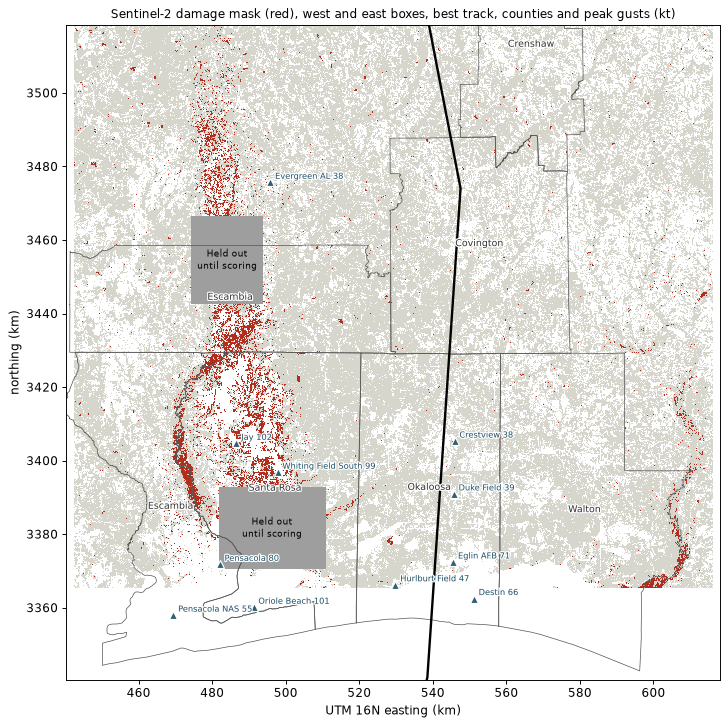
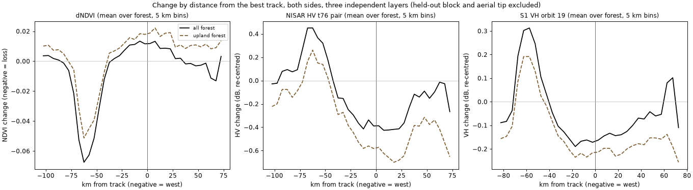
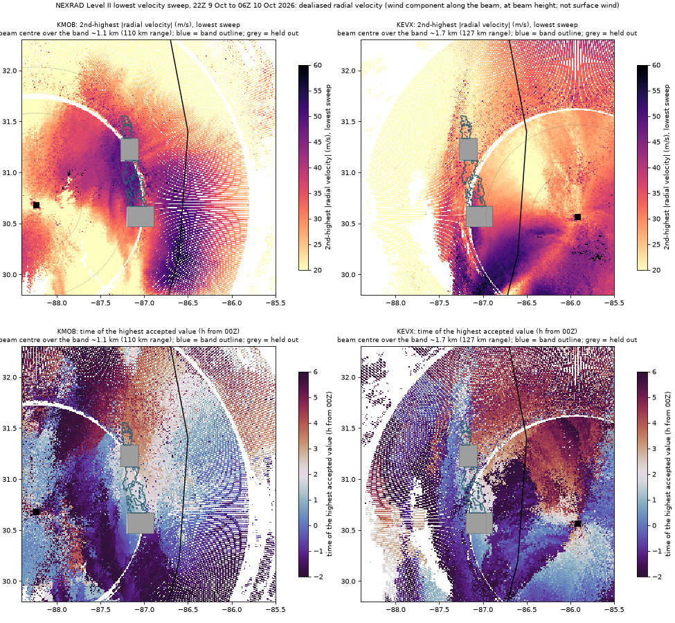
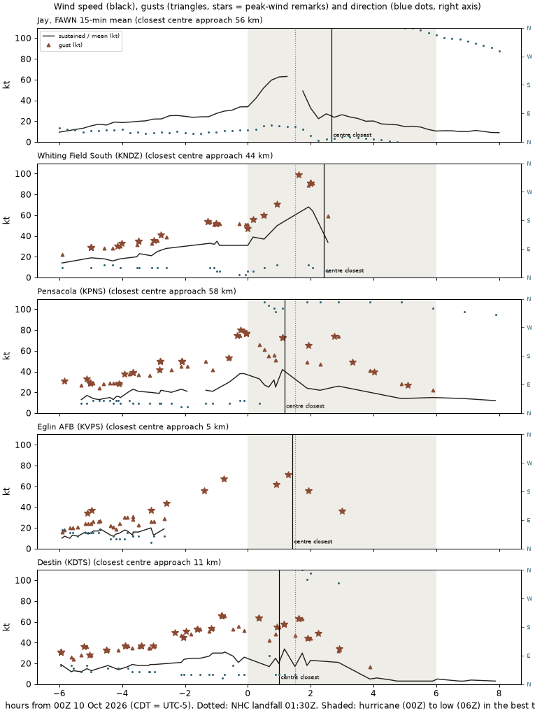
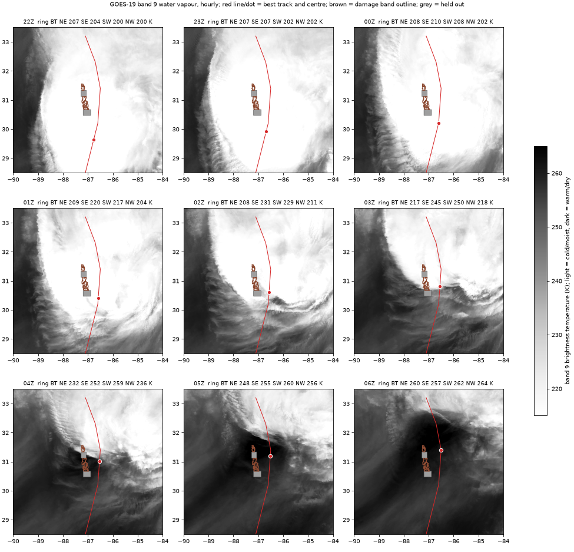

# Wind and damage: Hurricane Isaias (AL092026)

Branch `site`. The damage here is the **Sentinel-2 damage mask** (pipeline step 4), not model output.

The held-out block (lat 31.14–31.32, plus a 2 km buffer) and the aerial tip (plus a 2 km buffer) are left out of every number and figure. They show as grey, "Held out until scoring".

Scripts:
- [wind_link.py](../../scripts/wind_link.py) (west box)
- [wind_link_both.py](../../scripts/wind_link_both.py) (both sides)
- [station_timing.py](../../scripts/station_timing.py)
- [goes_wv.py](../../scripts/goes_wv.py)
- [nexrad_maxvel.py](../../scripts/nexrad_maxvel.py) and [nexrad_fig.py](../../scripts/nexrad_fig.py)

The artifact check is in [artifact_check.md](artifact_check.md). Numbers: [wind.json](wind.json), [wind_both.json](wind_both.json). Station values and sources: [stations.json](stations.json). Downloaded sources are in `data/wind/sources/` (not in git).

## Track

NHC operational best track, ATCF b-deck `bal092026.dat`:
- Downloaded from `https://ftp.nhc.noaa.gov/atcf/btk/bal092026.dat` on 2026-11-10 (46 records, sha256 `1aa33d53…`).
- Peak 105 kt, 959 mb (9 Oct 12Z–18Z). 95 kt at 30.2°N 86.6°W at 10 Oct 00Z, then 45 kt at 31.4°N 86.5°W at 06Z (system type LO) and extratropical by 12Z.
- **Landfall:** NWS Mobile puts it near Destin around 8:30 PM CDT on 9 Oct (01:30Z), as a Category 2 with 105 mph winds. I placed it where the best track crosses the coast at 30.40°N, 86.58°W (about 01:00Z on the track's timing). Interpolating by time alone would put the 01:30Z position about 12 km inland, at 30.50°N. Along-track distances start from the coast crossing.
- **Analysed wind field (b-deck wind radii):**
  - At 00Z on 10 Oct: radius of maximum wind 15 nm (28 km). 64 kt winds reach 30 / 30 / 25 / 20 nm in the NE / SE / SW / NW quadrants, so hurricane-force winds extend about 37–46 km on the west side and about 56 km on the east side. 50 kt winds reach 60 / 70 / 50 / 70 nm.
  - At 18Z on 9 Oct the 64 kt radii were the same, with radius of maximum wind 20 nm.
  - By 06Z on 10 Oct, 34 kt radii only (radius of maximum wind 100 nm).

**The track runs north along the eastern edge of the study grid.** Every forest cell in the grid lies 0.6–104.5 km left (west) of the track, and none lies right of it.

## Peak gusts (kt) and their sources

Mapped stations:

| Station | Gust (kt) | Distance from track | Source of the value |
|---|---|---|---|
| Jay, FL (UF FAWN 110) | **102.2** | 56 km left | NWS Mobile Post Tropical Cyclone Report, Highest 10 Land Gusts (updated 10/23/2026). The NWS Mobile county impact narrative (Santa Rosa) gives "102 kts ... at a UF FAWN station in Jay". |
| Oriole Beach, FL (Texas Tech StickNet 0217A) | **101.3** | 48 km left (approx.) | Same NWS report. The impact narrative (Escambia, FL) gives "gusts measured 101 kts". |
| Whiting Field South (KNDZ, AWOS) | 99.0 | 44 km left | IEM ASOS archive: peak-wind remark in the 01:56Z report, peak at 01:37Z 10 Oct. Matches the NWS report's 99.0. |
| Pensacola Regional (KPNS) | 80 | 58 km left | IEM ASOS archive, 23:53Z 9 Oct |
| Eglin AFB (KVPS) | 71 | at the track (5 km right) | IEM ASOS archive (61 reports 22Z–06Z) |
| Destin–Fort Walton Beach (KDTS) | 66 | 11 km right | IEM ASOS archive (25 reports) |
| Pensacola NAS (KNPA) | 55 | 70 km left | IEM; only 4 reports 22Z–06Z |
| Hurlburt Field (KHRT) | 47 | 10 km left | IEM; only 2 reports 22Z–06Z |
| Duke Field (KEGI) | 39 | at the track (4 km right) | IEM; only 2 reports 22Z–06Z |
| Crestview (KCEW) | 38 | at the track (3 km right) | IEM (20 reports) |
| Evergreen, AL (KGZH) | 38 | 51 km left | IEM; only 5 reports 22Z–06Z |

Listed by NWS Mobile but not mapped, because no published coordinates were found:
- Navarre StickNet 91.5
- Ferry Pass StickNet 90.8
- Allentown StickNet 88.1
- UWF Pace Library (WeatherSTEM) 86.9
- Pensacola Beach (WeatherSTEM) 86.0
- Navarre Beach Marine Science Station (WeatherSTEM) 86.0
- Gulf Breeze (WxFlow) 82.6

**What was checked against station data:**
- **Jay's 102.2 kt** could not be checked against FAWN's public data: the public 15-minute file has no gust column. Its peak 15-minute mean wind on 9–10 Oct is 72.59 mph = 63.1 kt at 20:15, matching the NWS sustained value for Jay FAWN (63.1 kt).
- **Oriole Beach's 101.3 kt** has no independent check: StickNet data and coordinates weren't found. Its map position is the approximate location of the Oriole Beach community.
- **Whiting Field South's 99 kt** is confirmed in the IEM archive.
- **Stations with very few reports in the storm window** (fewer than 10 between 22Z and 06Z) probably had outages, so their peaks are unreliable. They're drawn hollow in the figure.
- NWS notes that point observations likely didn't sample the event's peak values, and that anemometer heights are under 20 m.

## West of the track (study box only)

Damage is concentrated in a band 45–75 km left of the track. The median damaged cell is 59.5 km left, with 10–90% between 70 and 45 km.

| Signed distance (km) | All forest | Upland | Wetland |
|---|---|---|---|
| −80 to −75 | 1.0% | 1.3% | 0.7% |
| −75 to −70 | 7.6% | 2.2% | 18.3% |
| −70 to −65 | 22.1% | 12.4% | 32.8% |
| −65 to −60 | **30.0%** | **22.4%** | 37.9% |
| −60 to −55 | 26.2% | 17.8% | **44.9%** |
| −55 to −50 | 22.9% | 17.6% | 36.3% |
| −50 to −45 | 13.6% | 12.7% | 13.5% |
| −45 to −40 | 6.1% | 6.1% | 8.6% |
| −40 to 0 | 0.4–1.3% | 0.2–0.8% | 0.1–4.5% |
| −105 to −80 | 0.7–1.0% | 0.6–1.3% | 0.5–1.2% |

The study box has no forest right of the track; the east box below adds that side.

Along the track, the damaged share is highest 20–70 km north of landfall: 10–13% of all forest, and wetland 17–25%. It drops to under 1% at 80–90 km, with a smaller rise around 120–130 km.

## Map

## Is the band an acquisition artefact?

No. The band and both edges survive a rebuild from one clear pre scene and one clear post scene (17 September and 20 October, Sentinel-2 relative orbit 40), and the tile-free radar sensors put them in the same place, within a median 1 km. Composite acquisition dates and counts show no systematic jump at the edges.

Three boundaries do come close in places:
- the MGRS tile boundary at 87.0°W, and the Sentinel-2 orbit 83 swath edge, both along the east edge at 30.65–30.95°N;
- the NISAR track 76 frame edge, at the band's northern tip.

There's no step at the tile line where the band is absent, in NDVI change or in the mask itself. The outline is built from Sentinel-2 alone. A local drop of 4–7 clear observations just inside the east edge at 30.72–30.83°N probably reflects the orbit 83 swath edge; it can't make the band, which the orbit-40-only rebuild reproduces.

Details: [artifact_check.md](artifact_check.md).

## Both sides of the track

An east box (lon −86.60 to −85.80, lat 30.40–31.80; Okaloosa and Walton counties, FL; Covington and Crenshaw, AL) was mapped with the same Sentinel-2 composites, dates and mask rules as the west box: [s2_stack_east.py](../../scripts/s2_stack_east.py), [reference_east.py](../../scripts/reference_east.py), [east_layers.py](../../scripts/east_layers.py). It holds 6,913 km² of forest and 111.6 km² of 10 m damage pixels.

| Side and distance from the track | Forest | Damage | Damaged share |
|---|---|---|---|
| West, 40–80 km | 3,272 km² | 487 km² | **14.9%** |
| West, 0–40 km | 4,249 km² | 27 km² | 0.64% |
| East, 0–40 km | 3,543 km² | 15 km² | 0.42% |
| West, all (0–110 km) | 9,436 km² | 530 km² | 5.6% |
| East, all (0–75 km) | 6,399 km² | 85 km² | 1.3% |

West-box figures exclude the held-out areas.

**East of the track:**
- **Upland forest** has 0.2–0.8% damaged share in every 5 km bin out to 75 km.
- **Woody wetland** stays at 0.3–2.6% out to 55 km, then rises to 6–12% at 55–70 km. On the map that rise appears to follow the Choctawhatchee River floodplain along the box's east edge, where flooding as well as wind could lower NDVI.
- **Along the track**, the first 10 km north of the coast on the east side shows 13%. That comes from what appears to be a wetland patch near the river mouth at the east end of Choctawhatchee Bay, about 60–70 km east of the track. Elsewhere on the east side it's 0.1–2.8%.

**In the optical mask and in both radars, the left-side concentration survives mapping the right side.** NWS Mobile's county reports don't fully agree; see below.

**The asymmetry doesn't depend on the mask threshold.** Three independent layers, averaged over forest by distance from the track ([east_profiles.py](../../scripts/east_profiles.py), [east_profiles.json](east_profiles.json)), show the same west-only signal:

| Layer (mean over forest) | 55–70 km west | 0–30 km east | 60–70 km east |
|---|---|---|---|
| Sentinel-2 NDVI change | −0.05 to −0.07 | about +0.01 | −0.01 |
| NISAR HV change, track 76 pair 5 → 17 Oct (dB) | +0.32 to +0.45 | −0.36 to −0.43 | −0.03 |
| Sentinel-1 VH change, orbit 19 (dB) | +0.25 to +0.30 | −0.13 to −0.15 | +0.10 |

Both radars are slightly darker near and east of the track. That wasn't investigated; wetness or soil-moisture differences are possible.

The east NISAR layer is a single track 76 pair because the west's four-scene stack can't be rebuilt there: it would also need the track 76 frame 17 granules for 23 September and 29 October, whose raw files were deleted. **Not downloaded.**

**County shares of mapped forest in the Sentinel-2 damage mask:**

| County | Mapped forest | Damage | Share |
|---|---|---|---|
| Santa Rosa, FL | 1,367 km² | 255 km² | 18.6% |
| Escambia, FL | 794 km² | 57 km² | 7.2% |
| Escambia, AL | 1,395 km² | 86 km² | 6.2% |
| Walton, FL | 1,602 km² | 23 km² | 1.45% |
| Crenshaw, AL | 620 km² | 3.6 km² | 0.58% |
| Covington, AL | 1,695 km² | 6.7 km² | 0.39% |
| Okaloosa, FL | 1,518 km² | 5.2 km² | 0.35% |

West-box parts exclude the held-out areas. County outlines are TIGER 2018 via Earth Engine.

**NWS Mobile against the map:**
- **Covington County:** NWS Mobile reports "widespread tree damage ... leading to a majority of roads becoming impassable and approximately 58% of the county without power." The mask finds little: 0.39% of mapped forest.
- **Okaloosa:** NWS reports "significant tree damage ... multiple hardwood and softwood tree snaps", most concentrated in the south and west. The mask finds 0.35%.
- **Santa Rosa:** NWS reports "catastrophic damage ... hundreds of trees snapped". The mask finds 18.6%, which agrees.

**Why the mask can miss reported damage.** The mask records canopy-scale loss of greenness and burn ratio in 10 m pixels against the 2025 change. Scattered falls of single trees along roads and power lines, which close roads and cut power, would not register. So the Covington and Okaloosa reports and the map aren't necessarily in conflict, but I haven't verified which explanation holds.

**Radar coverage of the east box:**
- Sentinel-1 orbit 19 covers all of its forest; orbit 92 covers none of it.
- The NISAR track 76 pair (5 → 17 October, the only raw granules still on disk) covers 98.7% of its forest.
- NISAR track 55 frame 73 covers about 21% of the east box. Its raw files were deleted after extraction, so mapping that part would mean re-downloading the frame 73 granules for 22 September, 4, 16 and 28 October, about 6 GB each. **Not downloaded; that needs your OK.**

## Wind mechanism evidence

### What NHC, NWS and the news said

- **NHC Forecast Discussion 14** (10 PM CDT, 9 Oct): "Isaias made landfall as a 90-kt hurricane at 0130 UTC near Destin, Florida ... Eglin AFB (KEVX) radar data and surface observations indicate damaging, gusty winds are persisting in the residual northern eyewall and in a band wrapping around the western side of the circulation." By Discussion 15 (09Z, 10 Oct) Isaias was post-tropical. ([NHC archive](https://www.nhc.noaa.gov/archive/2026/ISAIAS.shtml))
- **NWS Mobile Post Tropical Cyclone Report** (updated 23 Oct): it gives the gust table above and lists 0 tornadoes for the NWS Mobile/Pensacola area. It notes that point observations likely didn't sample the peak values.
- **Fox 10 (WALA), 14 Oct**: "Summary of the NWS post-storm report" attributes the inland wind strength to a sting jet: air descending from the cloud head as the storm collapsed into an extratropical cyclone. The article doesn't quote NWS or NHC for that explanation. ([link](https://www.fox10tv.com/2026/10/14/hurricane-isaias-summary-nws-post-storm-report/))
- **NHC's Tropical Cyclone Report for Isaias is still pending.** The NHC report index listed no report for AL092026 when checked on 2026-11-10.

### Radar: KMOB and KEVX, lowest elevation sweep, 22Z–06Z

Method:
- 57 volumes per radar from the public Level II archive on AWS (`unidata-nexrad-level2`).
- Velocities dealiased with Py-ART's region-based method. |V| above 75 m/s was dropped as a dealiasing failure.
- To keep one bad volume from setting a value, each point shows the **second-highest** |V| over the window.

Results:

| Radar | Beam centre over the band | Band (2nd-highest \|V\|, mean / 90th pct) | Same range outside the band | Time of highest value in the band |
|---|---|---|---|---|
| KMOB (west of the band) | 1.1–1.6 km, at 103–134 km range | 44 / 50 m/s | 35 / 46 m/s | median 01:56Z |
| KEVX (east of the band) | 1.3–2.3 km, at 107–160 km range | 30 / 37 m/s | 30 / 39 m/s | median 01:41Z |

What the radar shows:
- **KMOB:** the highest radial velocities lie east of the band, nearer the track. The band sits along the western edge of that broad zone, with higher values than ground at the same range outside it.
- **KEVX** shows no difference between the band and its surroundings. But over the band it looks almost across the reported wind: beam azimuth about 293°, wind from 030–048°, so it sees only 13–43% of that wind. KMOB (beam azimuth about 71°) sees 76–92%. KEVX's "no difference" therefore carries little weight.
- **Both** time the band's strongest radial winds at about 01:40–02:00Z, matching the station peaks.

Limits that matter here:
- Radial velocity is only the component along the beam. Both radars look roughly east–west across the band, so they mainly see the east–west component.
- It's measured 1–2 km above the ground, where winds can differ from surface winds. The heights use each radar's lowest velocity tilt, checked in the files: VCP 212 with lowered base tilts of 0.17° (KMOB) and 0.31° (KEVX).
- **The band lies near or beyond both radars' unambiguous Doppler range** (the white ring at about 115 km), where data are partly range-folded.
- The radar can't resolve a swath a few km wide at this range.

### Timing at the gust stations

| Station (distance from track) | Peak | Time | From | Relative to the centre's closest approach |
|---|---|---|---|---|
| Whiting Field South (44 km W) | 99 kt gust | 01:37Z | 030° (NNE) | 0.8 h **before** (02:25Z) |
| Pensacola (58 km W) | 80 kt gust | 23:53Z | 040° (NE) | 1.3 h before (01:10Z) |
| Jay, FAWN 15-min mean (56 km W) | 63 kt mean (no gusts in public file) | 01:15Z | 048° (NE) | 1.4 h before (02:40Z); the record has a gap at 01:30Z |
| Eglin AFB (at the track) | 71 kt gust | 01:17Z | 360° (N) | 0.1 h before |
| Destin (11 km E) | 66 kt gust | 23:12Z | 020° (NNE) | 1.8 h before |

FAWN's clock is local CDT (UTC−5), inferred from solar noon in its radiation record. No public time series was found for the Oriole Beach StickNet.

Whiting Field's record is sparse: no routine report between 00:56Z and 01:56Z, so the 01:37Z peak comes from a peak-wind remark. It continues past the centre's closest approach (reports at 02:04, 02:33, 02:47 and 02:56Z) with no higher gust. Pensacola's and Jay's records are continuous through the window and carry the "before the centre passed" finding most firmly.

**The peak gusts came before the centre passed the stations' latitude, from the north-northeast to northeast, while Isaias was still a hurricane.** NHC had landfall at 01:30Z and 80 kt at 03Z, and declared it post-tropical at 09Z; the best track switches from hurricane to low between 00Z and 06Z. The peaks were not after the centre passed, and not after the transition.

### Dry air: GOES-19 band 9 water vapour, hourly

Mean brightness temperature 40–120 km from the centre, by quadrant (warmer means drier):
- **00Z:** all quadrants cold (202–210 K).
- **01Z:** the south side starts warming (SE 220, SW 217 K).
- **02Z:** SE 231, SW 229 K; the north stays at 208–211 K.
- **03Z:** SE 245, SW 250 K.
- **04–05Z:** all quadrants warm.

A dry slot wraps into the south and southwest side from about 01Z. It reaches the southern end of the band around 03Z and covers the band by 04–05Z: one to three hours after the station peaks, which happened while the band was under cold, moist cloud. The images are hourly, and mid-level water vapour doesn't show near-surface dryness.

### Candidate explanations

None of these is claimed. The evidence above bears on each as follows.

| Candidate | What the evidence supports | What it does not support |
|---|---|---|
| **Sting jet** (Fox 10) | Isaias was collapsing and losing tropical character within hours of landfall. A dry slot did develop on the south side. Sting jets are narrow and short-lived, so sparse stations and hourly imagery could miss one. | The station peaks came 1–2 h before the centre passed, from the NE–NNE, during the hurricane phase and before the dry slot reached the band. Sting jets usually come with the dry slot during frontal fracture. No observation here places descending cloud-head air over the band. |
| **Dry-air intrusion** | Dry air wrapped into the south and southwest side from 01Z and over the band by 04–05Z. It could have helped mix momentum down after the peaks. | The measured peaks came before the dry air arrived over the band. Sentinel-2 can't tell when the trees fell. |
| **Mesovortex or tornado swath** | NHC saw damaging gusts in a band wrapping around the western side on KEVX radar. Rotating features in that band could leave narrow swaths. | The damage band is about 10–22 km wide over most of its length (3–8 km at its ends) and about 120 km long, larger than one mesovortex or tornado track. NWS Mobile lists 0 tornadoes. The radar can't resolve small vortices over the band (1–2 km beam, partly range-folded). |
| **Edge of the western wind field** | The damage sits at and just beyond NHC's analysed western 64 kt radius (37–46 km) and inside the 50 kt radius. The peak winds came from the NE–NNE before the centre passed, i.e. in the storm's western and northwestern quadrant. KMOB shows the band at the western edge of strong radial winds, timed with the station peaks. NHC described a damaging band on the western side. | It doesn't explain why the west was much more damaged than the east, where NHC's hurricane-force radius was slightly larger. The east-side stations near landfall that kept reporting peaked lower. KMOB's strongest radial winds lie east of the band, not in it. |
| **Error in the operational track** | The b-deck fixes are rounded to 0.1° (about 10 km), and the inland track wasn't checked against radar centre fixes here. | NWS Mobile's lowest pressures were at Crystal Beach (977.9 mb) and Destin airport (981.7 mb), both beside the track at landfall, which puts the centre near the track there. A 45–75 km error would be needed to move the band to the right side. |

## Does the damage sit where the strongest winds were expected?

No. For a northward-moving hurricane, the strongest winds are usually expected right of the track near landfall, here east of the track around Destin and Fort Walton Beach. The Sentinel-2 damage mask instead concentrates 45–75 km **left** (west) of the track, about 20–70 km north of landfall.

That pattern survives three tests:
- an artifact check of the optical data;
- a single-date rebuild;
- mapping the right side, where upland damage stays below 1% at every distance.

The highest gusts, all from the north-northeast to northeast before the centre passed, are on the same western side.

Why the worst damage fell there is an **open question**. A sting jet, a dry-air intrusion, a mesovortex or tornado swath, the edge of the western wind field and an error in the operational track have all been offered or can be imagined. The evidence gathered here fits some better than others, as set out above, but doesn't settle it. NHC's Tropical Cyclone Report, still pending, may.

## Not verified

- **Raw-data checks:** Jay's 102.2 kt gust against raw FAWN data (no gust in the public file); the coordinates and data of the StickNet stations, including Oriole Beach.
- **Station outages:** whether ASOS stations with few storm-window reports failed or just reported less often.
- **East-box radar:** the east box's radar layers are partial (Sentinel-1 orbit 19 only; NISAR track 76 single pair only). Track 55 frame 73 and track 76 frame 17 for 23 Sep and 29 Oct were not downloaded.
- **Radar quality:** Doppler velocities over the band are near or beyond the unambiguous range and depend on dealiasing, which was capped, not hand-checked.
- **Damage timing:** when the trees fell. Sentinel-2 composites can't time it.
- **County disagreement:** whether scattered single-tree damage explains the gap between the NWS reports and the mask in Covington and Okaloosa counties.
- **The track:** the operational best track may be revised in NHC's Tropical Cyclone Report. It was used as downloaded.
